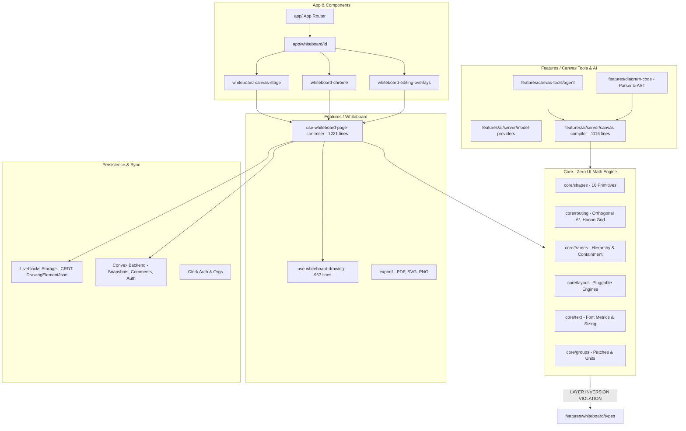
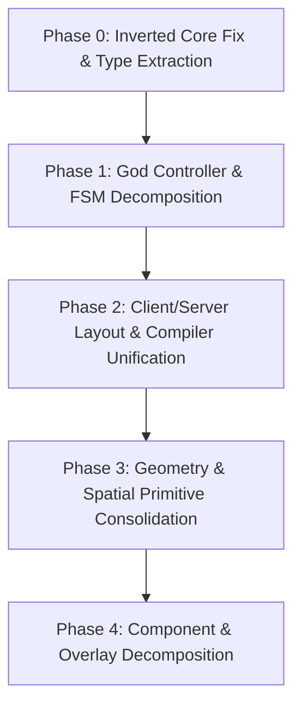

# Draw Anything: Modularization & Architecture Audit

**Status Date:** 2026-11-07  
**Auditor:** Senior Frontend Systems Engineer  
**Scope:** Entire Codebase (`core/`, `features/`, `convex/`, `app/`, `components/`, `lib/`, `tests/`)  
**Objective:** Comprehensive analysis of system architecture, modularization bottlenecks, coupling issues, circular dependencies, oversized god objects, and duplicate business logic.

---

## Table of Contents
1. [Executive Summary](#1-executive-summary)
2. [Current Architecture Overview](#2-current-architecture-overview)
3. [Major Architectural Problems](#3-major-architectural-problems)
4. [Deep Dive: Files Requiring Modularization](#4-deep-dive-files-requiring-modularization)
5. [Dependency and Coupling Analysis](#5-dependency-and-coupling-analysis)
6. [Duplicate & Fragmented Business Logic](#6-duplicate--fragmented-business-logic)
7. [Exemplary Modularized Subsystems](#7-exemplary-modularized-subsystems)
8. [Prioritized Roadmap for Modularization](#8-prioritized-roadmap-for-modularization)

---

## 1. Executive Summary

Draw Anything is a sophisticated, highly capable visual collaboration and AI diagramming engine built on **Next.js 15 (App Router)**, **React 19**, **Liveblocks (CRDT WebSocket storage)**, **Convex (serverless relational persistence)**, and **Clerk (authentication)**. It features an orthogonal A* connector router, a declarative diagramming DSL, 17+ domain shape primitives, and an autonomous AI canvas agent.

However, rapid iterative feature additions (the layout engine migration, first-class frames, structured UML/ER/Sequence shapes, and the canvas agent unification) have introduced severe architectural friction:
1. **Layer Inversion:** The pure geometry foundation (`core/`) has an inverted dependency on a UI feature layer (`features/whiteboard/types/whiteboard.types.ts` is imported by **141 core files**).
2. **God Objects:** `use-whiteboard-page-controller.ts` (1,221 lines) and `canvas-compiler.ts` (1,116 lines) centralize dozens of unrelated concerns.
3. **Monolithic Gesture Machine:** `use-whiteboard-drawing.ts` (967 lines) inlines 8 disparate interaction workflows in single pointer callbacks.
4. **Namespace Confusion & Client/Server Bleed:** Pure client-side layout algorithms and compilers reside in `features/ai/server/`, forcing client tools to import from `server/` paths.
5. **Prop Drilling of Mega-Controllers:** The 65-property `WhiteboardPageController` object is passed through 5 UI hierarchy tiers, causing cascading re-renders.

No source code has been altered during this audit. This document provides concrete evidence, line citations, problem analyses, and non-destructive remediation strategies.

---

## 2. Current Architecture Overview



### Subsystem Boundaries & Responsibilities

| Subsystem | Directory | Intended Responsibility | Actual State |
| :--- | :--- | :--- | :--- |
| **App Routing** | `app/` | Next.js routes, server route handlers (`/api/ai/canvas-agent`, `/api/liveblocks-auth`). | Clean. Routes delegate immediately to domain handlers. |
| **Core Engine** | `core/` | Framework-free geometry, shapes, routing, frames, groups, collision, text measurement, icons, colors. | Highly functional algorithms, but compromised by layer inversion (imports `features/whiteboard/types`) and framework leakage (`use-magnetic-snap.ts`). |
| **Whiteboard Feature** | `features/whiteboard/` | Canvas UI, pointer interaction, selection inspector, toolbar chrome, export pipelines. | God controller (`use-whiteboard-page-controller`), monolithic gesture FSM (`use-whiteboard-drawing`), and houses foundational types. |
| **AI Subsystem** | `features/ai/` | LLM adapters (Anthropic, OpenAI, Gemini, Groq), system prompts, diagram-agent playbooks. | Fractured. Half lives in `features/ai/`, half in `features/canvas-tools/`. Client compilers reside under `server/`. |
| **Canvas Tools** | `features/canvas-tools/` | Atomic canvas editing tools executed by the AI agent (`create`, `connect`, `edit`, `arrange`, `frames`). | Excellent tool design, but `edit.ts` is oversized (690 lines) and mixes 10 distinct tools. |
| **Diagram Code** | `features/diagram-code/` | Bidirectional text DSL for diagrams (Eraser-like language), parser, serializer, tooling. | Clean parser architecture, but tightly coupled to `features/ai/server/canvas-compiler.ts`. |
| **Backend & Sync** | `convex/`, `liveblocks.config.ts` | Relational document store (Convex) and live CRDT element list (Liveblocks). | Clean separation of access rules; type desynchronization between `DrawingElement` and `DrawingElementJson`. |

---

## 3. Major Architectural Problems

### 3.1 Problem A: Inverted Core Dependency (Layer Inversion)
- **Affected Files:**
  - `features/whiteboard/types/whiteboard.types.ts`
  - 141 files in `core/` (e.g., `core/frames/frame-api.ts`, `core/routing/types.ts`, `core/shapes/base/base-shape-definition.ts`, `core/arrow/connector-router.ts`, `core/layout/types.ts`)
  - `core/frames/frame-api.ts:8` (imports `withInternalConnectors` from `@/features/whiteboard/utils/move-plan`)
- **Why It Is Problematic:**
  In a clean layered architecture, `core/` must be a self-contained, domain-agnostic library containing pure geometry, mathematical models, and shape definitions with zero knowledge of higher-level feature modules or UI code. Currently, `DrawingElement`, `Point`, `Bounds`, `WhiteboardData`, `ElementType`, and `ConnectionHandle` are defined in `features/whiteboard/types/whiteboard.types.ts`.
  Because `core/` needs these types, **141 files in `core/` import upward into `features/`**. Even worse, `core/frames/frame-api.ts` imports a utility function `withInternalConnectors` from `features/whiteboard/utils/move-plan.ts`.
- **How It Should Be Addressed:**
  1. Extract foundational document, element, point, and geometry types into `core/model/` (or `core/types/`):
     - `core/model/element.ts`: `BaseDrawingElement`, `DrawingElement`, `ElementType`.
     - `core/model/geometry.ts`: `Point`, `Bounds`, `Size`, `Offset`.
     - `core/model/connections.ts`: `ConnectionHandle`, `ArrowConnection`, `ConnectorRelation`.
  2. Move `withInternalConnectors` from `features/whiteboard/utils/move-plan.ts` into `core/groups/transform.ts` or `core/frames/internal-connectors.ts`.
  3. Re-export these types from `features/whiteboard/types/whiteboard.types.ts` to maintain 100% backward compatibility with existing feature imports.

---

### 3.2 Problem B: The God Controller & Monolithic Prop Drilling
- **Affected Files:**
  - `features/whiteboard/hooks/controller/use-whiteboard-page-controller.ts` (1,221 lines)
  - `features/whiteboard/components/canvas/whiteboard-canvas-room.tsx`
  - `features/whiteboard/components/canvas/whiteboard-canvas-stage.tsx`
  - `features/whiteboard/components/chrome/whiteboard-chrome.tsx`
  - `features/whiteboard/components/overlays/whiteboard-editing-overlays.tsx`
  - `features/whiteboard/components/chrome/selection-inspector.tsx`
  - `features/whiteboard/components/chrome/floating-properties-panel.tsx`
  - `features/canvas-tools/editor/use-canvas-agent.ts`
- **Why It Is Problematic:**
  `useWhiteboardPageController` combines **65 distinct responsibilities**: Liveblocks storage subscriptions, Convex queries, undo/redo dispatch, autosave debouncing, viewport panning/zooming, element mutations, selection management, frame resizing, icon picking, shape insertion, diagram code compilation, text editing overlays, and export triggers.
  It returns a monolithic object typed as `WhiteboardPageController`. This object is passed down as a prop through 5 layers of React components (`WhiteboardCanvasRoom` -> `WhiteboardCanvasStage` -> `WhiteboardChrome` -> `SelectionInspector`).
  **Performance Impact:** Whenever a single property on the controller changes (e.g. an element moves 1 pixel, updating `selectedElements`), every child component receiving `controller` is subject to unnecessary re-renders unless wrapped in brittle memoization guards.
- **How It Should Be Addressed:**
  Decompose `useWhiteboardPageController` into focused React Context slices using the Composite Context pattern:
  - `WhiteboardDocumentContext`: Holds live elements, Liveblocks mutations (`addElement`, `updateElement`, `deleteElementsLive`, `applyDocPatch`).
  - `WhiteboardSelectionContext`: Holds `selectedElements`, `selectionOverlay`, `handleSelectAll`, `handleClearSelection`.
  - `WhiteboardViewportContext`: Holds `zoom`, `panOffset`, `worldToScreen`, `screenToWorld`, `fitToScreen`.
  - `WhiteboardToolsContext`: Holds active tool, drawing mode, snap settings, color/stroke styles.
  Components consume only the exact context slice they need (`useWhiteboardSelection()`, `useWhiteboardViewport()`), eliminating prop drilling and preventing canvas stage re-renders when chrome toggles change.

---

### 3.3 Problem C: Monolithic Gesture State Machine
- **Affected Files:**
  - `features/whiteboard/hooks/interaction/use-whiteboard-drawing.ts` (967 lines)
- **Why It Is Problematic:**
  `useWhiteboardDrawing` handles pointer interactions for the canvas. Although helper files like `draft-element.ts` and `gesture-scratch.ts` were previously extracted, the three core callbacks (`startDrawing`, `draw`, `stopDrawing`) remain an immense monolithic state machine spanning hundreds of lines.
  It manages 8 disparate interaction modes within the same closures:
  1. Shape drafting (freehand, rectangle, circle, diamond, pill)
  2. Element dragging and multi-selection movement
  3. Bounding box resize handles
  4. Arrow waypoint / bend point adjustment
  5. Connection arrow pulling from shape anchor ports
  6. Marquee area selection
  7. Viewport panning
  8. Frame boundary resizing
  Modifying the drag behavior of an arrow or adding snap guidelines risks unintended regressions in marquee selection or frame resizing because all state variables (`gesture`, `cursorPosition`, `connectionDraft`, `alignmentGuides`) share the same scope.
- **How It Should Be Addressed:**
  Adopt a Strategy / Sub-machine pattern:
  - `GestureDispatcher`: Evaluates initial pointer event and delegates to an active gesture controller.
  - Separate gesture handlers implementing a unified contract:
    - `useDrawGestureHandler`: Freehand and primitive shape drafting.
    - `useDragGestureHandler`: Selection translation with alignment guides.
    - `useResizeGestureHandler`: Single and group bounding box scaling.
    - `useConnectorGestureHandler`: Anchor connection creation and snap resolution.
    - `useMarqueeGestureHandler`: Area selection calculation.
    - `useFrameResizeHandler`: Dedicated frame boundary adjustments.

---

### 3.4 Problem D: Misplaced "Server" Directory & Fragmented AI Pipeline
- **Affected Files:**
  - `features/ai/server/canvas-compiler.ts` (1,116 lines)
  - `features/ai/server/layout/*` (12 layout engine files)
  - `features/ai/server/validation.ts` (513 lines)
  - `features/ai/server/layout/pins.ts`
  - `features/diagram-code/canvas.ts`
  - `features/diagram-code/pins.ts`
  - `features/diagram-code/language/resolve.ts`
  - `features/canvas-tools/agent/*` vs `features/ai/diagram-agent/*`
- **Why It Is Problematic:**
  1. **False Server Boundary:** Directory `features/ai/server/` contains `canvas-compiler.ts`, `pins.ts`, and the entire `layout/` directory. These modules are **not** server-only; they are pure JavaScript/TypeScript compilers and graph placement engines that are imported into client components (such as `features/diagram-code/canvas.ts`, `features/diagram-code/pins.ts`, and `diagram-code-editor.tsx`). Naming this directory `server/` creates false assumptions, violates Next.js bundling conventions, and makes it impossible to enforce strict server/client boundaries (e.g. `import "server-only"`).
  2. **AI Subsystem Fracture:** Following the unification of the AI agent into `features/canvas-tools/agent/`, `features/ai/diagram-agent/` was left with fragmented prompt playbooks, lint tools, and transports. As a result, `features/canvas-tools/agent/prompt.ts` imports from `@/features/ai/diagram-agent/prompt/examples`, while `features/canvas-tools/agent/transport.ts` imports from both `@/features/ai/server/model-providers` and `@/features/ai/diagram-agent/transports/create`.
- **How It Should Be Addressed:**
  1. Move pure diagram compilation, pins, and layout algorithms out of `features/ai/server/` into a shared module:
     - Move `features/ai/server/layout/*` to `core/layout/algorithms/` or `features/ai/layout/`.
     - Move `canvas-compiler.ts`, `pins.ts`, and `validation.ts` to `features/ai/compiler/`.
     - Restrict `features/ai/server/` exclusively to actual Node.js server code (`model-providers.ts`, `request-guard.ts`, `route.ts`).
  2. Merge the orphan contents of `features/ai/diagram-agent/` (playbooks, prompt context, lint rules) into `features/ai/prompt/` and `features/ai/lint/`.

---

### 3.5 Problem E: Fragmented & Duplicated Layout Engines
- **Affected Files:**
  - `core/layout/` (`record.ts`, `placement.ts`, `types.ts`, `engines/freeform/`)
  - `features/ai/server/layout/` (`architecture-engine.ts`, `layered-placement.ts`, `grid-placement.ts`, `family-placement.ts`, `bus.ts`, `channels.ts`, `er/`, `sequence/`, `mindmap/`)
  - `features/whiteboard/commands/layout.ts` (512 lines)
  - `features/whiteboard/commands/layout-engine.ts`
- **Why It Is Problematic:**
  There are three distinct, uncoordinated layout engines in the codebase:
  1. **Core Pluggable Architecture:** `core/layout/types.ts` defines `LayoutEngine` (`layout`, `update`), `LayoutRecord`, and `placement: auto|user`.
  2. **AI Server Layout Pipeline:** `features/ai/server/layout/` contains complex graph placement algorithms (Layered Sugiyama, Bus routing, Channel allocation, ER foreign key placement, Sequence lifelines).
  3. **Ad-Hoc Whiteboard Commands:** `features/whiteboard/commands/layout.ts` implements a completely separate set of layout algorithms (`LayoutAlgorithm = "layered" | "row" | "column" | "grid" | "circle"`) written directly against `CommandContext` and `UnitBox`.
  This duplication means that if a user clicks "Layout..." in the editor toolbar, it runs the ad-hoc command in `commands/layout.ts`; if the AI runs `layout_diagram`, it runs through `features/whiteboard/commands/layout-engine.ts`; and if diagram code compiles, it runs through `features/ai/server/layout/family-placement.ts`.
- **How It Should Be Addressed:**
  Consolidate all layout execution behind the `core/layout` registry:
  - Migrate the geometric algorithms in `features/whiteboard/commands/layout.ts` (row, column, grid, circle) into formal `LayoutEngine` implementations registered in `core/layout/engines/`.
  - Unify `features/ai/server/layout/` algorithms under `core/layout/algorithms/`.
  - Ensure the editor's Layout Panel, diagram code apply, and the AI agent all execute layout via the identical `planEngineLayout` pipeline.

---

### 3.6 Problem F: Framework Pollution in Pure Core
- **Affected Files:**
  - `core/arrow/use-arrow-connections.ts` (340 lines)
  - `core/snap/use-magnetic-snap.ts` (228 lines)
- **Why It Is Problematic:**
  `core/` is documented as:
  > *"Framework-free engine: shapes, routing, anchors, snap, collision, text, icons, color, theme, arrow. Zero UI dependency."*
  However, `use-magnetic-snap.ts` and `use-arrow-connections.ts` directly import `useCallback` and `useMemo` from `"react"`.
  Inside `core/snap/use-magnetic-snap.ts`, core geometric algorithms (`buildGridIndex`, `findNearestSnap`, `MagneticSnapMatch`) are bundled inside a React hook. Non-React consumers (such as server-side layout engines, web workers, headless canvas tests, or AI validation tools) cannot utilize anchor snapping without mocking React hook lifecycles.
- **How It Should Be Addressed:**
  1. Extract pure mathematical functions to `core/snap/magnetic-snap.ts`:
     - `createAnchorSpatialIndex(anchors: Anchor[]): AnchorSpatialIndex`
     - `findNearestAnchorSnap(point: Point, index: AnchorSpatialIndex, options): SnapMatch | null`
  2. Keep only a thin React adapter hook in `features/whiteboard/hooks/interaction/use-magnetic-snap.ts`.
  3. Relocate `use-arrow-connections.ts` to `features/whiteboard/hooks/interaction/use-arrow-connections.ts`.

---

## 4. Deep Dive: Files Requiring Modularization

### 4.1 `features/whiteboard/hooks/controller/use-whiteboard-page-controller.ts` (1,221 Lines)
- **Current Responsibilities:**
  - Liveblocks storage synchronization and optimistic mutations.
  - Convex whiteboard data fetching and title renaming.
  - Autosave debouncing and unmount flushing.
  - Viewport zoom, pan, and fit-to-screen transforms.
  - Pointer drawing state binding.
  - Multi-selection, marquee, and group traversal.
  - Shape, icon, and frame creation and property mutations.
  - Text editing overlay lifecycle.
  - Undo/redo history bracketing.
  - Export dialog and board rasterization trigger.
  - Diagram code compilation bridging.
  - Canvas agent live preview synchronization.
- **Modularization Plan:**
  Decompose into 5 cohesive sub-controllers:
  1. `useWhiteboardStorageController`: Owns Liveblocks `useStorage`, live element seeding, `addElement`, `updateElement`, `deleteElementsLive`, and `applyDocPatch`.
  2. `useWhiteboardSelectionController`: Owns `selectedElements`, group hierarchy drilling (`enteredGroupId`), `selectionOverlay`, and alignment commands.
  3. `useWhiteboardEditingController`: Owns shape double-click, label editing, inline text block lifecycle, and structured shape editor.
  4. `useWhiteboardCommandsController`: Dispatches keyboard shortcuts, frame auto-fit, z-order arranging, and style updates.
  5. `useWhiteboardPersistenceController`: Coordinates Convex snapshots, autosave state, and access permissions.

---

### 4.2 `features/ai/server/canvas-compiler.ts` (1,116 Lines)
- **Current Responsibilities:**
  - Main compilation entrypoint: `compileAIDiagramToCanvas` and `compileAIDiagramDetailed`.
  - Node sizing: delegates to `core/text/node-size.ts`, calculating bounding dimensions for 12 shape types.
  - Handle & Port selection: chooses attachment ports for edges based on flow direction and node layout.
  - Bus Routing & Bundling: merges fan-out connections into shared trunks (`bundleFans`).
  - Structured Shape Generation: generates entity table rows, UML class compartments, and mindmap node structures.
  - Frame Construction: wraps grouped nodes in first-class frames, nested hierarchy levels, and title bands.
  - Connector Drafting & Routing: converts AI edges into `RouteArrowDescriptor` batches and executes `routeArrowBatch`.
  - Edge Label Placement: calculates midpoints, tangent angles, and text boxes for connector labels.
- **Modularization Plan:**
  Break into 4 discrete pipeline stages:
  1. `compiler/node-factory.ts`: Creates element objects with calculated bounds, color palettes, and icons (`buildNodeElements`).
  2. `compiler/frame-builder.ts`: Analyzes `AIDiagramGroup` hierarchy, generates nested frames, and promotes group frames (`buildGroupFrames`).
  3. `compiler/edge-builder.ts`: Resolves port fractions, assigns side anchors, handles parallel edge spreading, and builds connector descriptors (`buildEdgeDescriptors`).
  4. `compiler/pipeline.ts`: Thin orchestrator executing stages: `Prepare -> Place -> Build Nodes -> Build Frames -> Route Edges -> Place Labels`.

---

### 4.3 `features/whiteboard/hooks/interaction/use-whiteboard-drawing.ts` (967 Lines)
- **Current Responsibilities:**
  - Maintains `gesture` state machine (`idle`, `drawing`, `dragging`, `resizing`, `connecting`, `marquee`, `arrow-bend`, `frame-resize`).
  - Manages pointer capture, mouse/touch event normalizations, and cursor position tracking.
  - Implements smart drag alignment guidelines (`alignmentGuides`, `alignmentSpans`).
  - Inlines connector creation, magnetic anchor snap previews, and connection drops.
  - Handles single and multi-element resize calculations with aspect-ratio locks.
- **Modularization Plan:**
  Extract dedicated gesture controllers using a shared gesture interface:
  ```ts
  interface GestureHandler<TState> {
    onStart: (point: Point, event: React.PointerEvent) => TState | null;
    onMove: (point: Point, state: TState, event: React.PointerEvent) => void;
    onEnd: (point: Point, state: TState, event: React.PointerEvent) => void;
    onCancel: (state: TState) => void;
  }
  ```
  - `handlers/drag-gesture.ts`: Smart drag session, guides, snapping.
  - `handlers/resize-gesture.ts`: Bounding box and frame resizing.
  - `handlers/connector-gesture.ts`: Dragging new connectors from ports.
  - `handlers/draw-gesture.ts`: Shape drafting and freehand points.
  - `handlers/marquee-gesture.ts`: Box area selection.

---

### 4.4 `core/frames/frame-api.ts` (889 Lines)
- **Current Responsibilities:**
  - Frame creation, updating, renaming, and deletion.
  - Geometry calculations: `moveFrame`, `resizeFrame`, `fitFrameToContent`, `planAutoFit`.
  - Containment & Hierarchy: `assignToFrame`, `removeFromFrame`, `nestFrame`, `reparentMoved`.
  - Lane & Pool management: `arrangeLanes`, `moveLane`.
  - Batching: `combine`, `updateFrames`, `fitFrames`.
  - Imports `withInternalConnectors` from `features/whiteboard/utils/move-plan`.
- **Modularization Plan:**
  Split into cohesive modules under `core/frames/`:
  1. `core/frames/frame-lifecycle.ts`: `createFrame`, `updateFrame`, `renameFrame`, `deleteFrame`.
  2. `core/frames/frame-geometry.ts`: `moveFrame`, `resizeFrame`, `fitFrameToContent`, `planAutoFit`.
  3. `core/frames/frame-hierarchy.ts`: `assignToFrame`, `removeFromFrame`, `nestFrame`, `reparentMoved`.
  4. `core/frames/frame-lanes.ts`: `arrangeLanes`, `moveLane` (BPMN pool/lane layout).
  5. `core/frames/frame-api.ts`: Facade re-exporting all functions to keep imports intact.

---

### 4.5 `features/canvas-tools/tools/edit.ts` (690 Lines)
- **Current Responsibilities:**
  - Implements 10 distinct AI agent tools in one file: `style`, `set_label`, `set_text`, `rotate`, `move`, `z_order`, `lock`, `unlock`, `hide`, `show`.
  - Each tool defines its own Zod schema, validation rules, target resolution, and error messages.
- **Modularization Plan:**
  Split into individual tool files under `features/canvas-tools/tools/edit/`:
  - `tools/edit/style-tool.ts`: Color, fill, stroke width, opacity, corner radius, typography.
  - `tools/edit/label-tool.ts`: Shape labels and text block content.
  - `tools/edit/transform-tool.ts`: Translation (`move`) and rotation (`rotate`).
  - `tools/edit/order-tool.ts`: Z-order modifications.
  - `tools/edit/visibility-tool.ts`: Lock/unlock and hide/show.
  - `tools/edit/index.ts`: Combines tools into `editTools` array for registration.

---

### 4.6 `features/team/components/team-view.tsx` (780 Lines)
- **Current Responsibilities:**
  - Workspace team member table, role badges, action dropdowns.
  - Pending invitation management and revocation.
  - Invite team members modal dialog with multi-email parsing.
  - Role change confirmation dialog.
  - Member removal confirmation dialog.
  - Search filtering, pagination, and skeleton loading states.
- **Modularization Plan:**
  Decompose into component hierarchy under `features/team/components/`:
  - `team-members-table.tsx`: Clean data table rendering member rows.
  - `team-invites-table.tsx`: Pending invites section.
  - `team-invite-modal.tsx`: Multi-email invitation dialog.
  - `team-member-row.tsx`: Single member display with role dropdown.
  - `team-view.tsx`: Thin container managing state and action handlers.

---

### 4.7 `features/whiteboard/components/overlays/whiteboard-editing-overlays.tsx` (539 Lines)
- **Current Responsibilities:**
  - Inlines the complete `ShapeLabelEditor` component (300+ lines) with complex DOM contentEditable event handling, keydown listeners, and font auto-scaling.
  - Renders 11 separate overlays: `CanvasTextBlock`, `StructuredEditor`, `FrameTitleEditor`, `ShapePicker`, `IconPicker`, `LayoutPanel`, `CommandMenu`, `ExportDialog`, `KeyboardShortcuts`, `DiagramCodePanel`, and `AIPanel`.
- **Modularization Plan:**
  1. Extract `ShapeLabelEditor` to its own file: `features/whiteboard/components/overlays/shape-label-editor.tsx`.
  2. Keep `whiteboard-editing-overlays.tsx` purely as a declarative overlay orchestrator.

---

### 4.8 `features/whiteboard/components/chrome/selection-inspector.tsx` (535 Lines)
- **Current Responsibilities:**
  - Inlines transform inputs (X, Y, W, H, Rotation, Aspect Ratio).
  - Inlines alignment & distribution controls.
  - Inlines grouping and lock/unlock buttons.
  - Inlines semantic node icon presets, placement selectors, and corner radius sliders.
  - Inlines frame-specific title and preset properties.
- **Modularization Plan:**
  Extract sections into sub-components under `features/whiteboard/components/chrome/inspector/`:
  - `transform-section.tsx`: Bounds, rotation, aspect ratio lock.
  - `alignment-section.tsx`: Align modes and distribute axis.
  - `group-actions-section.tsx`: Group, ungroup, lock, unlock.
  - `semantic-style-section.tsx`: Icon size, icon placement, corner radius.
  - `frame-properties-section.tsx`: Frame titles and presets.

---

## 5. Dependency and Coupling Analysis

### 5.1 Inter-Module Dependency Matrix
Based on static import analysis of 614 TypeScript source files across the project:

```
[core]                  imports from -> features/whiteboard (141 files: types & move-plan)
[core]                  imports from -> features/ai (1 file: legacy-corpus)
[core]                  imports from -> features/diagram-code (1 file: legacy-corpus)
[features/ai]           imports from -> core (15 files)
[features/ai]           imports from -> features/whiteboard (13 files: types)
[features/ai]           imports from -> features/diagram-code (3 files)
[features/canvas-tools] imports from -> core (26 files)
[features/canvas-tools] imports from -> features/ai (9 files)
[features/canvas-tools] imports from -> features/diagram-code (7 files)
[features/canvas-tools] imports from -> features/whiteboard (27 files)
[features/diagram-code] imports from -> core (8 files)
[features/diagram-code] imports from -> features/ai (9 files: server compiler & pins)
[features/diagram-code] imports from -> features/whiteboard (8 files: types)
[features/whiteboard]   imports from -> core (69 files)
[features/whiteboard]   imports from -> features/ai (4 files)
[features/whiteboard]   imports from -> features/canvas-tools (5 files)
[features/whiteboard]   imports from -> features/diagram-code (4 files)
```

### 5.2 Circular Dependency Cycles (Type & Value)
Three circular import chains exist in the project:

#### Cycle 1: Canvas Agent UI Messages
```
features/canvas-tools/editor/use-canvas-agent.ts
  └─> imports { fromRows, toRow } from "./persisted-messages"
features/canvas-tools/editor/persisted-messages.ts
  └─> imports type { AgentUiMessage } from "./use-canvas-agent"
```
- **Issue:** A data conversion helper (`persisted-messages.ts`) depends on a 423-line React hook (`use-canvas-agent.ts`) solely for a type definition.
- **Fix:** Move `AgentUiMessage` to `features/canvas-tools/types.ts`.

#### Cycle 2: Whiteboard Command Context & Connectors
```
features/whiteboard/commands/connectors.ts
  └─> imports type { CommandContext } from "./context"
features/whiteboard/commands/context.ts
  └─> imports { rerouteWithLabels } from "./connectors"
```
- **Issue:** `context.ts` defines `interface CommandContext` and its factory `createCommandContext`, which executes runtime routing via `rerouteWithLabels`.
- **Fix:** Move `interface CommandContext` to `features/whiteboard/commands/types.ts`.

#### Cycle 3: Icon Definition & Validation
```
core/icons/registry.ts
  └─> imports { validateCustomIcon } from "./custom-icon"
core/icons/custom-icon.ts
  └─> imports type { IconDef } from "./registry"
```
- **Issue:** `custom-icon.ts` imports `type IconDef` from `registry.ts`, while `registry.ts` imports validation logic.
- **Fix:** Move `IconDef` into `core/icons/types.ts`.

### 5.3 Liveblocks & Convex Data Contract Desynchronization
- **Issue:** `liveblocks.config.ts` declares:
  ```ts
  export type DrawingElementJson = JsonObject & {
    id: string;
    type: string;
    points: { x: number; y: number }[];
    // ...
  };
  ```
  This is a hand-written partial mirror of `DrawingElement`. It is missing newly introduced structured shape fields (`tableData`, `classifierData`, `mindmapData`, `lifelineData`), first-class frame fields (`frameId`), and layout stamps (`placement`).
  Because `DrawingElementJson` extends `JsonObject`, properties slip through unchecked, but TypeScript cannot validate that all fields written to storage match the true shape definitions.
- **Fix:** Derive `DrawingElementJson` directly from `DrawingElement` using TypeScript mapped types:
  ```ts
  export type DrawingElementJson = JsonObject & ToJson<DrawingElement>;
  ```

---

## 6. Duplicate & Fragmented Business Logic

### 6.1 Duplicate Bounding Box & AABB Types
Three separate modules independently define bounding boxes and implement duplicate geometric operations:

| Type | Module | Properties | Duplicate Methods Implemented |
| :--- | :--- | :--- | :--- |
| `Bounds` | `features/whiteboard/types/whiteboard.types.ts` | `minX, minY, maxX, maxY, width, height` | `makeBounds`, `unionBounds` (`core/geometry/box.ts`) |
| `Box` | `features/ai/server/layout/geometry.ts` | `minX, minY, maxX, maxY` | `overlaps`, `overlapArea`, `inset`, `intersectsLine` |
| `Aabb` | `core/collision/aabb.ts` | `minX, minY, maxX, maxY` | `expandAabb`, `aabbOverlap`, `pointInAabb` |

- **Impact:** Functions in `core/` and `features/ai/` constantly convert between `Bounds` and `Box` or recreate helper functions.
- **Fix:** Establish a single canonical `core/geometry/bounds.ts` module providing `interface Bounds` and comprehensive geometric predicates (`union`, `inset`, `overlaps`, `intersects`, `containsPoint`).

### 6.2 Manual World-to-Screen Transforms (108 Occurrences)
- **Impact:** 108 instances of manual coordinate arithmetic (`point.x * zoom + panOffset.x`) are scattered across 21 files in `core/` and `features/whiteboard/`.
- **Fix:** Provide a centralized `ViewportTransform` class/object in `core/geometry/viewport.ts`:
  ```ts
  export class ViewportTransform {
    constructor(public zoom: number, public panOffset: Point) {}
    worldToScreen(p: Point): Point;
    screenToWorld(p: Point): Point;
    worldBoundsToScreen(b: Bounds): Bounds;
  }
  ```

### 6.3 Duplicate Color & Contrast Utilities
- `core/color/adaptive-color.ts` implements color luminance and contrast calculation.
- `features/whiteboard/utils/canvas-render-utils.ts` historically duplicated luminance calculation.
- `features/ai/server/canvas-compiler.ts` implements its own `kindColors` palette mapping.
- **Fix:** Centralize all palette resolution under `core/color/`.

---

## 7. Exemplary Modularized Subsystems

The audit identified several subsystems that exhibit exemplary architecture, clean boundaries, and zero external entanglements:

1. **`core/color/` (`adaptive-color.ts`, `named-colors.ts`, `theme-contrast.ts`)**
   - Pure, deterministic, zero-dependency mathematical color functions.
   - 100% testable without DOM, Canvas context, or framework mocking.
2. **`core/text/` (`typography.ts`, `label-layout.ts`, `node-size.ts`, `estimate.ts`)**
   - Clean abstractions for font metrics, world-unit line heights, and dynamic node sizing.
   - Clear contract consumed consistently by shapes and layout engines.
3. **`features/diagram-code/language/` (`ast.ts`, `parser.ts`, `format.ts`, `diagnostics.ts`, `vocab.ts`)**
   - Beautifully designed compiler front-end.
   - Lexing, parsing, formatting, and AST analysis are decoupled from rendering and execution.
4. **`convex/lib/` (`accessRules.ts`, `commentRules.ts`)**
   - Pure authorization predicates.
   - Reusable across Convex backend queries, Next.js API routes, and Liveblocks authentication webhooks without database coupling.
5. **`features/whiteboard/export/` (`svg-context.ts`, `deliver.ts`, `selection-policy.ts`)**
   - Excellent boundary design: separates canvas rendering commands from output delivery (download, clipboard, PDF packaging).
6. **`core/groups/patch.ts` & `core/groups/units.ts`**
   - Robust atomic change representation (`DocPatch`).
   - Every mutation is represented as pure data `{ add, update, remove }`, enabling single-undo-step guarantees.

---

## 8. Prioritized Roadmap for Modularization



### Phase 0: Break Inverted Dependencies & Extract Core Types (High Impact, Safe)
- [ ] Create `core/model/` and move foundational interfaces (`DrawingElement`, `BaseDrawingElement`, `Point`, `Bounds`, `ConnectionHandle`, `ConnectorRelation`) from `features/whiteboard/types/` into `core/model/`.
- [ ] Re-export all types from `features/whiteboard/types/whiteboard.types.ts` to preserve backwards compatibility across feature files.
- [ ] Move `withInternalConnectors` out of `features/whiteboard/utils/move-plan.ts` into `core/frames/`.
- [ ] Eliminate the 3 circular import cycles (`persisted-messages.ts`, `context.ts`, `registry.ts`) by introducing dedicated `types.ts` files.
- [ ] **Verification:** `npx tsc --noEmit` and `npm run build`.

### Phase 1: Decouple God Controller & Drawing FSM (Performance & Stability)
- [ ] Decompose `use-whiteboard-page-controller.ts` into 4 focused sub-hooks:
  - `useWhiteboardStorage`: Liveblocks synchronization & patch dispatch.
  - `useWhiteboardSelection`: Selection state, marquee, group drill-down.
  - `useWhiteboardCommands`: Shortcuts, z-order, alignment, frame auto-fit.
  - `useWhiteboardEditing`: Label editing, text blocks, structured shape overlays.
- [ ] Introduce React Context slices (`DocumentContext`, `SelectionContext`, `ViewportContext`) to eliminate prop-drilling the 65-property controller through canvas stages.
- [ ] Extract gesture strategies from `use-whiteboard-drawing.ts` into discrete handlers (`drag`, `resize`, `connector`, `marquee`, `draw`).
- [ ] **Verification:** Canvas interaction and editing regression testing.

### Phase 2: Unify Layout Engines & Relocate Client Compilers (Architecture Cleanliness)
- [ ] Relocate pure client layout algorithms from `features/ai/server/layout/` to `core/layout/algorithms/`.
- [ ] Relocate `canvas-compiler.ts`, `pins.ts`, and `validation.ts` to `features/ai/compiler/`.
- [ ] Consolidate the ad-hoc layout algorithms in `features/whiteboard/commands/layout.ts` into formal `core/layout` engines.
- [ ] Merge orphan `features/ai/diagram-agent/` playbooks and tools into `features/ai/prompt/` and `features/ai/lint/`.
- [ ] **Verification:** Diagram code compile tests and AI agent execution tests.

### Phase 3: Geometry & Framework Cleansing (Maintainability & Engine Purity)
- [ ] Consolidate `Bounds`, `Box`, and `Aabb` into a single canonical `core/geometry/bounds.ts`.
- [ ] Create `core/geometry/viewport.ts` and replace the 108 manual inline `* zoom + panOffset` calculations with `worldToScreen` / `screenToWorld`.
- [ ] Extract pure mathematical functions from `core/snap/use-magnetic-snap.ts` and `core/arrow/use-arrow-connections.ts`, moving React hooks to `features/whiteboard/hooks/`.
- [ ] Synchronize `DrawingElementJson` in `liveblocks.config.ts` with `DrawingElement`.
- [ ] **Verification:** `npx tsc --noEmit` and full engine test suite.

### Phase 4: UI Component & Overlay Modularization (Developer Velocity)
- [ ] Extract `ShapeLabelEditor` from `whiteboard-editing-overlays.tsx` into a standalone component.
- [ ] Break `features/canvas-tools/tools/edit.ts` into individual tool modules (`style`, `label`, `transform`, `order`, `visibility`).
- [ ] Split `features/team/components/team-view.tsx` into table, invite modal, and member row components.
- [ ] Split `selection-inspector.tsx` into transform, alignment, grouping, and styling sub-sections.
- [ ] **Verification:** `npm run lint` and `npm run build`.

