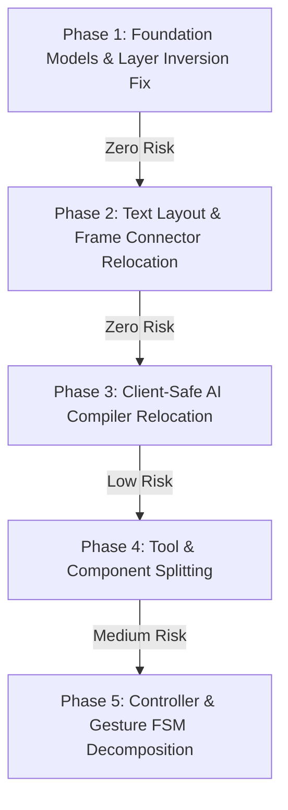

# Draw Anything: Modularization Plan & Audit Review

**Status Date:** 2026-11-07  
**Document Purpose:** Verification of `MODULARIZATION_AUDIT.md`, architectural boundary definitions, and a low-risk, evidence-based migration plan.  
**Constraint Enforcement:** No source code modifications are performed in this plan. Implementation begins only upon user approval.

---

## 1. Audit Verification Matrix

Every finding from `docs/architecture/MODULARIZATION_AUDIT.md` was independently evaluated against the live codebase. Below is the verification status, verified evidence, and corrections.

| # | Audit Claim | Status | Live Evidence / Verification | Corrections & Critical Nuances |
| :--- | :--- | :--- | :--- | :--- |
| **1** | **141 core files import `whiteboard.types.ts`** | **Partially Verified (Refined)** | Exactly **137** files in `core/` import `whiteboard.types.ts`. Exactly **7** files in `core/` import other feature utilities. Total core files importing `features/` is 141. | The audit counted 141 total feature imports. 137 are `whiteboard.types.ts`. More crucially, 5 core files (`core/text/estimate.ts`, `core/text/label-layout.ts`, `core/shapes/text/geometry.ts`, `core/shapes/text/renderer.ts`, `core/shapes/base/shape-label-renderer.ts`) import `rich-text-renderer` from `features/whiteboard/utils/`. |
| **2** | **`core/frames/frame-api.ts` imports `move-plan.ts`** | **Verified** | `core/frames/frame-api.ts:8`: `import { withInternalConnectors } from "@/features/whiteboard/utils/move-plan";`. | `withInternalConnectors` is pure graph partitioning logic. It belongs in `core/frames/` or `core/groups/`, not in a whiteboard UI utility. |
| **3** | **God Controller `use-whiteboard-page-controller.ts` (1,221 lines, 65 properties)** | **Verified** | Verified line count: exactly 1,221 lines. Return object contains 65 distinct functions, state variables, and sub-controllers. | **Correction to Audit's Proposed Solution:** Do NOT split the controller into 4-5 nested React Contexts. Context-based splitting triggers tree-wide reconciliations during 60 FPS pointer drags and breaks caller contracts. Controller must remain a single hook facade internally composed of focused sub-hooks. |
| **4** | **Monolithic Drawing FSM `use-whiteboard-drawing.ts` (967 lines)** | **Verified** | Verified line count: exactly 967 lines. Inlines 8 gesture flows (freehand, drag, resize, arrow bend, connect, marquee, pan, frame resize) in `startDrawing`, `draw`, and `stopDrawing`. | Extracting gesture strategies into dedicated handlers (`useDragGesture`, `useResizeGesture`, `useConnectorGesture`) is validated, provided the unified `gesture` state machine transitions are preserved. |
| **5** | **Circular Dependencies: 3 Cycles** | **Partially Verified (Corrected)** | Cycles verified: 1) `registry.ts` <-> `custom-icon.ts`; 2) `connectors.ts` <-> `context.ts`; 3) `use-canvas-agent.ts` <-> `persisted-messages.ts`. | **Critical Correction:** There are **ZERO runtime cycles** in the codebase. All 3 cycles use `import type`, which is completely erased at compile time. They represent type organization smells, not runtime bundling failures. |
| **6** | **Client/Server Namespace Leak in `features/ai/server/`** | **Verified** | `canvas-compiler.ts` (1,116 lines), `layout/*` (12 files), and `validation.ts` reside under `features/ai/server/`, but are bundled and executed in client browser components (`features/diagram-code/canvas.ts`, `features/diagram-code/pins.ts`, `diagram-code-editor.tsx`). | Pure graph compilation and placement algorithms are not server-only. They must be moved to a shared compiler directory with re-export bridges to prevent client/server confusion. |
| **7** | **Fragmented & Duplicated Layout Engines** | **Partially Verified (Corrected)** | 6 of 7 pluggable layout engines are ALREADY consolidated in `core/layout/engines/` (`bpmn`, `er`, `freeform`, `mind-map`, `sequence`, `uml`). Only `architecture-engine.ts` is in `features/ai/server/layout/`. | **Correction to Audit Claim:** `features/whiteboard/commands/layout.ts` (512 lines) is NOT a competing layout engine for the Layout Panel. It is the implementation for the editor's "Organize" / "Tidy" commands (`planAutoLayout`, `planTidy`). |
| **8** | **Duplicate Bounding Box Types (`Bounds`, `Box`, `Aabb`)** | **Verified** | `Bounds` (`whiteboard.types.ts`), `Aabb` (`core/collision/aabb.ts`), and `Box` (`features/ai/server/layout/geometry.ts`) duplicate `{ minX, minY, maxX, maxY }`. `features/whiteboard/commands/connectors.ts` imports `Box` and `pathHitsBox` from `features/ai/server/layout/geometry`. | `Box` and `Aabb` are identical. Unifying collision boxes under `core/collision/` eliminates the abnormal dependency of whiteboard commands on AI layout geometry. |
| **9** | **108 Inline `* zoom + panOffset` Calculations across 21 files** | **Verified (Flawed Audit Solution)** | Verified exactly 108 occurrences across 21 files. | **Critical Performance Correction:** The audit proposed replacing all 108 inline calculations with a `ViewportTransform` class allocating `{x, y}` Point objects. Doing this inside `renderToCanvas` loops (drawing 1000+ shapes at 60 FPS) will cause severe GC thrashing and frame drops. Inline scalar math must be preserved in high-frequency render loops. |
| **10** | **AI Tool Clumping in `features/canvas-tools/tools/edit.ts` (690 lines)** | **Verified** | 10 distinct tools (`style`, `set_label`, `set_text`, `rotate`, `move`, `z_order`, `lock`, `unlock`, `hide`, `show`) are clumped into one 690-line file. | Safe and beneficial to split into individual tool handlers. |
| **11** | **Framework Pollution in `core/` (`use-magnetic-snap.ts`, `use-arrow-connections.ts`)** | **Verified** | Both files directly import React (`useCallback`, `useMemo`). `core/snap/use-magnetic-snap.ts` embeds pure spatial grid algorithms inside a React hook. | Decouple pure math (`findNearestSnap`, `buildGridIndex`) from React hook wrappers. |
| **12** | **`DrawingElementJson` Desynchronization in `liveblocks.config.ts`** | **Verified** | `DrawingElementJson` hand-writes partial properties, omitting `frameId`, `placement`, `tableData`, `classifierData`, `mindmapData`, `lifelineData`, and forcing `as unknown as DrawingElement` throughout `storage-writes.ts`. | Safe type derivation will eliminate unsafe double type assertions. |

---

## 2. Strict Architectural Boundaries & Dependency Rules

To prevent architectural regression, every subsystem is assigned clear responsibilities and non-negotiable import rules:

```
┌────────────────────────────────────────────────────────┐
│                        app/                            │  Routes, Next.js Page Handlers, Server Actions
└──────────────────────────┬─────────────────────────────┘
                           │ (imports only)
┌──────────────────────────▼─────────────────────────────┐
│                     features/                          │  Domain Features, UI Components, React State
│   [whiteboard]      [ai]      [canvas-tools]  [code]   │  Orchestration, Export Pipelines
└────────────┬─────────────┬──────────────┬──────────────┘
             │             │              │ (imports only)
┌────────────▼─────────────▼──────────────▼──────────────┐
│                       core/                            │  Framework-Free Domain Engine:
│  [model]  [shapes]  [routing]  [frames]  [layout]      │  Pure Math, Geometry, Algorithms, ASTs
│  [text]   [color]   [icons]    [snap]    [collision]   │  ZERO React / DOM Dependencies
└────────────────────────────────────────────────────────┘
```

### Boundary Contract

1. **`core/` Boundary Rules:**
   - **MUST NOT** import from `features/`, `app/`, `components/`, or `convex/`.
   - **MUST NOT** import from `"react"`, `"react-dom"`, or any UI framework.
   - **MUST BE** 100% executable in Node.js, Web Workers, or headless test runners.
   - Contains all document primitives, shape definitions, routing algorithms, frame containment, and text metrics.

2. **`features/` Boundary Rules:**
   - May import from `core/`, `components/`, `convex/`, and `lib/`.
   - Cross-feature imports between `features/whiteboard`, `features/ai`, `features/canvas-tools`, and `features/diagram-code` must go through declared feature entry points (`index.ts` or public APIs), not private internal subpaths.
   - Client code in `features/` must **never** import from a subfolder named `server/`.

3. **`app/` Boundary Rules:**
   - Acts as a thin composition layer for Next.js routing.
   - Dispatches immediately to feature controllers or API route handlers.
   - Contains no business logic or custom canvas math.

4. **`convex/` Boundary Rules:**
   - Backend functions, database schemas, mutations, and queries.
   - May import from `lib/` for shared authorization rules (`accessRules.ts`), but never from `features/` or `app/`.

5. **`lib/` Boundary Rules:**
   - Shared, cross-cutting utilities only (e.g. `lib/utils.ts` for `cn`, `lib/security/csp.ts` for CSP headers, `lib/authz/room-access.ts`).
   - Must not become a catch-all dumping ground for feature logic.

---

## 3. Target Directory Structure

The following structural alignment resolves all verified layer inversions while preserving 100% backward compatibility via re-export shims:

```text
core/
├── model/                         # NEW: Canonical Document & Geometry Models
│   ├── element.ts                 # BaseDrawingElement, DrawingElement, ElementType, StoredElement
│   ├── geometry.ts                # Point, Bounds, Size, Offset, Box
│   ├── connections.ts             # ConnectionHandle, ArrowConnection, ConnectorRelation, Anchor
│   └── index.ts                   # Re-exported for core consumers
├── text/
│   ├── rich-text-layout.ts        # MOVED from features/whiteboard/utils/ (pure text layout)
│   ├── rich-text-markup.ts        # MOVED from features/whiteboard/utils/ (markdown token parsing)
│   └── estimate.ts                # Pure text width & height estimation
├── snap/
│   ├── magnetic-snap.ts           # NEW: Pure spatial grid indexing & snap algorithms
│   └── index.ts
features/
├── whiteboard/
│   ├── types/
│   │   └── whiteboard.types.ts    # Re-exports from @/core/model + UI CanvasState & Tool
│   ├── hooks/
│   │   ├── interaction/
│   │   │   ├── use-magnetic-snap.ts   # MOVED: Thin React hook adapter over core/snap
│   │   │   ├── use-arrow-connections.ts # MOVED: React hook from core/arrow/
│   │   │   └── gestures/          # Sub-handlers extracted from use-whiteboard-drawing
│   │   │       ├── use-drag-gesture.ts
│   │   │       ├── use-resize-gesture.ts
│   │   │       └── use-connector-gesture.ts
│   │   └── controller/
│   │       ├── use-whiteboard-page-controller.ts # Preserved public API, refactored internal composition
│   │       ├── use-keyboard-shortcuts.ts         # Extracted 100+ line shortcut runner
│   │       ├── use-frame-operations.ts           # Extracted frame property & fitting hooks
│   │       └── use-element-insertion.ts          # Extracted icon, shape, & editing triggers
│   └── utils/
│       └── rich-text-renderer.ts  # Thin facade re-exporting from core/text
├── ai/
│   ├── compiler/                  # MOVED from features/ai/server/ (Client-safe compiler)
│   │   ├── canvas-compiler.ts     # compileAIDiagramToCanvas, buildCanvas
│   │   ├── pins.ts                # NodePin tracking
│   │   └── validation.ts          # Normalization & document validation
│   ├── server/                    # STRICTLY Server-side Node.js code
│   │   ├── model-providers.ts     # LangChain multi-provider adapters (Anthropic, OpenAI, etc.)
│   │   ├── request-guard.ts       # Rate limiting & body size validation
│   │   └── canvas-compiler.ts     # Backward-compatible re-export from @/features/ai/compiler
```

---

## 4. Detailed Module Deconstruction Plans

### 4.1 Foundational Model Extraction (`core/model/`)
- **Justification:** Eliminates 137 upward imports from `core/` to `features/whiteboard/types`.
- **Target Files:**
  - `core/model/geometry.ts`: `Point`, `Bounds`, `Size`, `Offset`.
  - `core/model/connections.ts`: `ConnectionHandle`, `AnchorSide`, `ArrowType`, `ArrowRoutingMode`, `ArrowheadKind`, `RelationKind`, `RelationNotation`, `Cardinality`, `ConnectorEnd`, `ConnectorRelation`, `Anchor`, `ArrowConnection`.
  - `core/model/element.ts`: `BaseDrawingElement`, all 17 shape interfaces (`FreehandShape`, `RectangleShape`, etc.), `DrawingElement`, `GroupRecord`, `LayoutRecord`, `StoredElement`.
  - `core/model/index.ts`: Bundles and exports the model.
- **Backward Compatibility:** `features/whiteboard/types/whiteboard.types.ts` becomes:
  ```ts
  export * from "@/core/model";
  // Retains whiteboard UI-specific types:
  export interface CanvasState { ... }
  export interface WhiteboardData { ... }
  export type Tool = string;
  ```
  **Risk:** Zero. All existing code importing `@/features/whiteboard/types/whiteboard.types` continues to compile without modification.

---

### 4.2 Rich Text Layout Relocation (`core/text/`)
- **Justification:** Resolves 5 layer violations where `core/text` and `core/shapes/text` import from `features/whiteboard/utils/rich-text-renderer`.
- **Target Files:**
  - Move `features/whiteboard/utils/rich-text-layout.ts` -> `core/text/rich-text-layout.ts`.
  - Move `features/whiteboard/utils/rich-text-markup.ts` -> `core/text/rich-text-markup.ts`.
  - Keep `features/whiteboard/utils/rich-text-renderer.ts` as a 2-line re-export facade:
    ```ts
    export * from "@/core/text/rich-text-markup";
    export * from "@/core/text/rich-text-layout";
    ```
- **Backward Compatibility:** Zero breaking changes. `core/text/estimate.ts` and `label-layout.ts` update imports to local siblings (`./rich-text-layout`).

---

### 4.3 Internal Connectors Relocation (`core/frames/`)
- **Justification:** Resolves layer violation in `core/frames/frame-api.ts:8`.
- **Target Files:**
  - Move `withInternalConnectors` from `features/whiteboard/utils/move-plan.ts` to `core/frames/internal-connectors.ts`.
  - Re-export `withInternalConnectors` from `features/whiteboard/utils/move-plan.ts`.
  - Update `core/frames/frame-api.ts` to import from `./internal-connectors`.

---

### 4.4 Whiteboard Page Controller Internal Modularization
- **Justification:** Reduces `use-whiteboard-page-controller.ts` from 1,221 lines to ~400 lines while preserving the exact `WhiteboardPageController` contract and avoiding React Context overhead.
- **Decomposition Design:**
  ```text
  use-whiteboard-page-controller.ts (Orchestrator Hook)
    ├── useKeyboardShortcuts.ts   # Lines 723-830: Shortcut execution dispatch
    ├── useFrameOperations.ts     # Lines 369-410: updateFrameProps, fitFramesToContent, commitDrawnFrame
    ├── useElementInsertion.ts    # Lines 602-660: insertIcon, insertShape, beginEditing
    └── useDiagramCodeSync.ts     # Lines 945-985: applyDiagramCode orchestration
  ```
- **Contract Guarantee:** `export type WhiteboardPageController = ReturnType<typeof useWhiteboardPageController>` remains identical. No child components require prop or signature changes.

---

### 4.5 Drawing Gesture Strategy Extraction
- **Justification:** Deconstructs the 967-line `use-whiteboard-drawing.ts` without destabilizing pointer state transitions.
- **Decomposition Design:**
  - Create `features/whiteboard/hooks/interaction/gestures/`:
    - `use-drag-gesture.ts`: Computes smart drag vectors, alignment guides, and delta applications.
    - `use-resize-gesture.ts`: Computes single and multi-shape bounding box resize math.
    - `use-connector-gesture.ts`: Handles anchor handle hover, line pulling, and connection drops.
  - `use-whiteboard-drawing.ts` retains pointer capture, cursor position, and high-level FSM transitions (`idle -> dragging -> committed`), delegating gesture math to the specialized hooks.

---

### 4.6 AI Compiler & Layout Relocation (Client-Safe)
- **Justification:** Eliminates client bundle confusion caused by `features/diagram-code/` importing from `features/ai/server/`.
- **Target Files:**
  - Move `features/ai/server/canvas-compiler.ts` -> `features/ai/compiler/canvas-compiler.ts`.
  - Move `features/ai/server/layout/pins.ts` -> `features/ai/compiler/pins.ts`.
  - Move `features/ai/server/validation.ts` -> `features/ai/compiler/validation.ts`.
  - Move `features/ai/server/layout/` -> `features/ai/layout/` (or `core/layout/algorithms/`).
  - Provide shim re-exports in `features/ai/server/` for all moved files.
  - Update `features/diagram-code/canvas.ts`, `pins.ts`, and `resolve.ts` to import from `@/features/ai/compiler/`.

---

### 4.7 AI Edit Tools Modularization
- **Justification:** Deconstructs `features/canvas-tools/tools/edit.ts` (690 lines) into isolated, single-responsibility tool definitions.
- **Decomposition Design:**
  - `features/canvas-tools/tools/edit/style.ts`: Style mutation tool.
  - `features/canvas-tools/tools/edit/text.ts`: `set_label` and `set_text` tools.
  - `features/canvas-tools/tools/edit/transform.ts`: `move` and `rotate` tools.
  - `features/canvas-tools/tools/edit/visibility.ts`: `lock`, `unlock`, `hide`, `show` tools.
  - `features/canvas-tools/tools/edit/order.ts`: `z_order` tool.
  - `features/canvas-tools/tools/edit/index.ts`: Combines tools into `editTools` array.
  - `features/canvas-tools/tools/edit.ts`: Re-exports `editTools` to maintain registry compatibility.

---

## 5. Migration Phases Ordered by Risk and Dependency

Each phase is self-contained, introduces zero regressions, and requires strict verification before proceeding to the next.



### Phase 1: Foundation Models & Layer Inversion Fix (Risk: Minimal)
- **Goal:** Establish `core/model/` and eliminate `core/` dependency on `features/whiteboard/types`.
- **Files to Create:**
  - `core/model/geometry.ts`
  - `core/model/connections.ts`
  - `core/model/element.ts`
  - `core/model/index.ts`
- **Files to Modify:**
  - `features/whiteboard/types/whiteboard.types.ts`: Re-export from `@/core/model`.
  - Batch update imports in `core/` to import from `@/core/model` (or local sibling).
- **Verification:**
  - `npx tsc --noEmit`
  - `npm run lint`
  - `npm run build`

### Phase 2: Text Layout & Frame Connector Relocation (Risk: Minimal)
- **Goal:** Relocate pure text algorithms and internal connector graph partitioning to `core/`.
- **Files to Move/Modify:**
  - Move `features/whiteboard/utils/rich-text-layout.ts` -> `core/text/rich-text-layout.ts`.
  - Move `features/whiteboard/utils/rich-text-markup.ts` -> `core/text/rich-text-markup.ts`.
  - Shim `features/whiteboard/utils/rich-text-renderer.ts`.
  - Create `core/frames/internal-connectors.ts` (contains `withInternalConnectors`).
  - Shim `features/whiteboard/utils/move-plan.ts`.
  - Update `core/frames/frame-api.ts` import.
- **Verification:**
  - `npx tsc --noEmit`
  - `npm run build`

### Phase 3: Client-Safe AI Compiler Relocation (Risk: Low)
- **Goal:** Disentangle client diagram-code from `features/ai/server/`.
- **Files to Move/Modify:**
  - Create `features/ai/compiler/` and move `canvas-compiler.ts`, `pins.ts`, `validation.ts`.
  - Move `features/ai/server/layout/` -> `features/ai/layout/`.
  - Create backward-compatible re-export shims in `features/ai/server/`.
  - Update imports in `features/diagram-code/` to use `@/features/ai/compiler/`.
- **Verification:**
  - `npx tsc --noEmit`
  - `npm run build`

### Phase 4: AI Tools & UI Component Decomposition (Risk: Low)
- **Goal:** Break down oversized single-file components.
- **Files to Modify:**
  - Decompose `features/canvas-tools/tools/edit.ts` into `features/canvas-tools/tools/edit/*.ts`.
  - Extract `ShapeLabelEditor` from `whiteboard-editing-overlays.tsx` into `shape-label-editor.tsx`.
  - Extract sub-sections from `selection-inspector.tsx` (`transform-section.tsx`, `alignment-section.tsx`).
  - Decompose `features/team/components/team-view.tsx` into sub-components.
- **Verification:**
  - `npx tsc --noEmit`
  - `npm run lint`
  - `npm run build`

### Phase 5: Controller & Gesture FSM Internal Decomposition (Risk: Medium)
- **Goal:** Decompose 1,221-line controller and 967-line drawing hook while preserving public signatures.
- **Files to Modify:**
  - Extract `useKeyboardShortcuts.ts`, `useFrameOperations.ts`, `useElementInsertion.ts` from `use-whiteboard-page-controller.ts`.
  - Extract `use-drag-gesture.ts`, `use-resize-gesture.ts`, `use-connector-gesture.ts` from `use-whiteboard-drawing.ts`.
- **Verification:**
  - `npx tsc --noEmit`
  - `npm run lint`
  - `npm run build`
  - Manual verification of whiteboard drawing, dragging, resizing, and keyboard shortcuts.

---

## 6. Required Regression Tests & Verification Protocol

After **every single phase**, execute the following verification suite:

1. **Type Integrity Check:**
   ```bash
   npx tsc --noEmit
   ```
   *Pass Criterion:* 0 errors.

2. **Lint Conformance Check:**
   ```bash
   npm run lint
   ```
   *Pass Criterion:* 0 warnings, 0 errors.

3. **Production Compilation & Bundling Check:**
   ```bash
   npm run build
   ```
   *Pass Criterion:* All 15 static and dynamic pages compile successfully with zero bundle boundary errors.

4. **Layer Boundary Verification Script:**
   Execute static analysis to ensure no new layer inversions are introduced:
   ```bash
   python3 -c '
   import os, re
   violations = []
   for root, dirs, files in os.walk("core"):
       for f in files:
           if f.endswith((".ts", ".tsx")):
               fp = os.path.join(root, f)
               content = open(fp).read()
               if re.search(r"from\s+[\"\x27]@/features/", content):
                   violations.append(fp)
   print(f"Core layer violations remaining: {len(violations)}")
   '
   ```
   *Pass Criterion:* Decreases to 0 as Phase 1 & 2 complete.

---

## 7. Rollback Considerations & Safety Guarantees

1. **Re-Export Shims Guarantee Zero Downstream Breakage:**
   Every moved file leaves an exact re-export shim in its original location during migration. If an unpredicted consumer still imports from the old path, the build will not break.
2. **Atomic Git Commits Per Phase:**
   Each phase (Phase 1 through Phase 5) must be committed in its own dedicated Git commit. If any manual testing reveals regressions, the phase can be reverted with `git revert <commit-hash>` without affecting other phases.
3. **No Algorithm Alterations:**
   No routing heuristics, layout placement math, or canvas render loops are altered. The code is simply rearranged into clean architectural modules.

---

## 8. Summary of Non-Adopted Audit Recommendations

For transparency, the following suggestions from the initial audit are explicitly rejected or deferred, in accordance with critical constraints:

| Proposed Audit Change | Reason for Rejection / Modification |
| :--- | :--- |
| **Splitting Controller into 4-5 React Contexts** | **Rejected.** Introduces Context nesting, risks 60 FPS canvas stage reconciliation stutter, and breaks existing caller contracts. Internal hook decomposition achieves identical modularity without runtime overhead. |
| **Replacing 108 inline `* zoom + panOffset` with `worldToScreen` methods** | **Rejected.** Canvas render loops draw thousands of shapes at 60 FPS. Instantiating Point objects inside tight render loops creates severe GC heap allocation churn. Raw numeric arithmetic is kept in render loops. |
| **Consolidating `commands/layout.ts` into `core/layout/`** | **Modified.** `commands/layout.ts` is not a duplicate diagram layout engine; it implements the editor's Organize/Tidy menu commands. It should remain in commands, scoped strictly to node alignment and tidying. |
| **Eliminating Type-Only Cycles immediately** | **Low Priority.** All 3 cycles are type-only (`import type`) and cause zero runtime or bundling issues. They will be resolved cleanly as part of Phase 1 type extraction. |

---

*Plan complete. Ready for implementation upon review and confirmation.*

