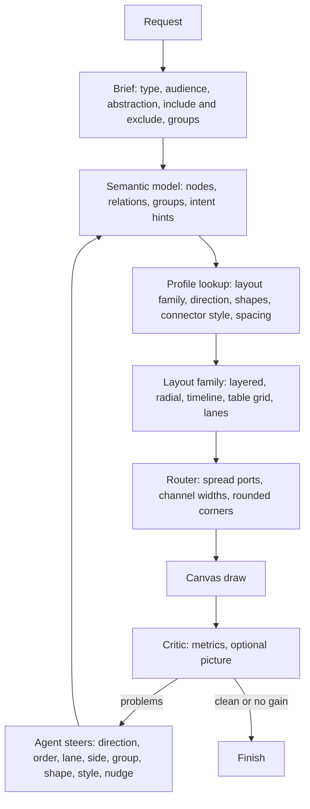
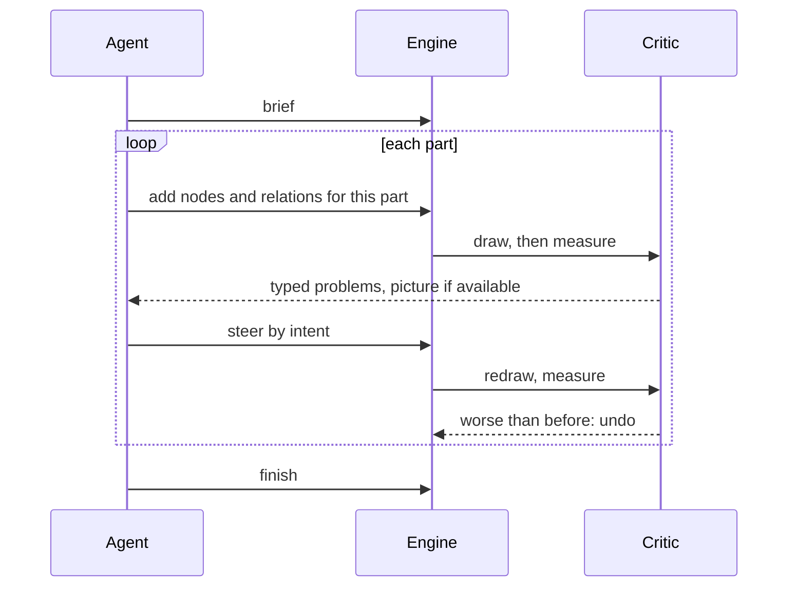
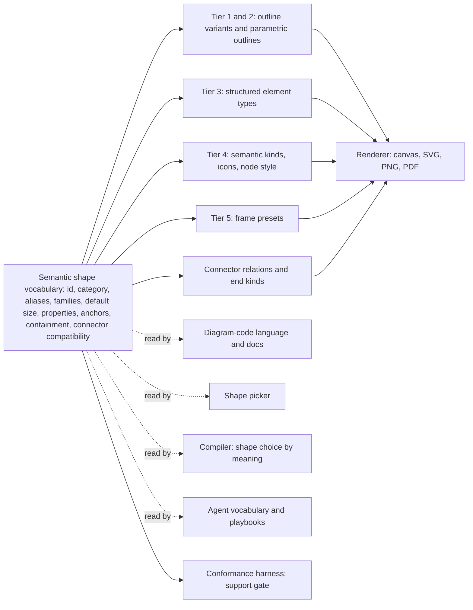
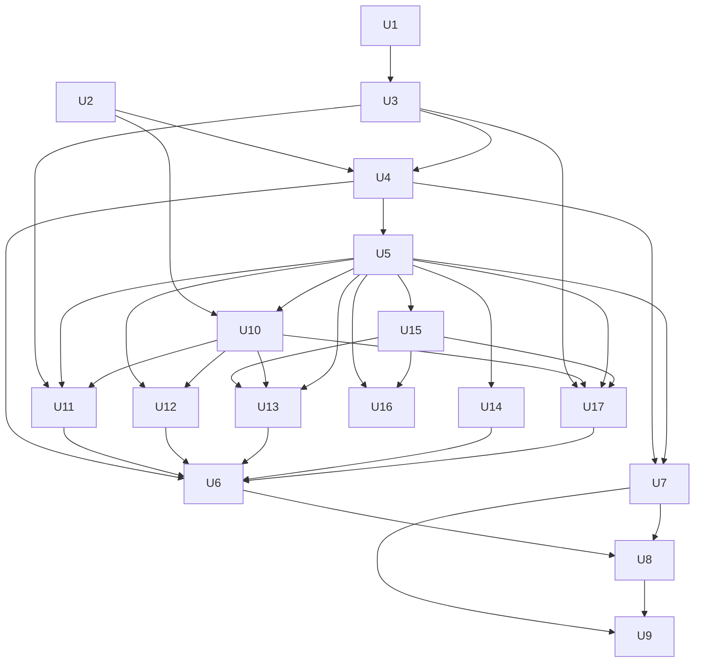

# Production-quality diagram agent - Plan

## Goal Capsule

- **Objective:** A person who asks for a system architecture, flowchart, ER diagram, sequence diagram or mind map gets a finished-looking diagram: grouped sensibly, readable at a glance, with arrows that do not cling to shapes. They do not have to ask for frames or groups, and they do not fix it by hand.
- **Means:** The app places and routes from the diagram's meaning and type. An agent builds the diagram in steps, sees each result, and steers by intent (KTD1, KTD2).
- **Authority:** Product Contract requirements, then Key Technical Decisions, then units. A unit overrides neither.
- **Stop conditions:** Stop and ask if a unit would change how stored boards are read (anchors, connector fields) in a way old boards cannot survive, or if measured results (U1) show a phase did not improve the score.
- **Execution profile:** Phased. Phase A is measurable and ships alone. Later phases build on the measured baseline.

---

## Product Contract

### Summary

Replace the "model writes a handful of nodes, engine routes sharp hugging arrows" behaviour with a pipeline whose parts each decide what they are best at. The model decides meaning, structure and fixes. A per-diagram-type profile decides layout family, direction, shapes, connector style and spacing. The router gives arrows room and rounded corners. A critic measures every step. A semantic shape vocabulary gives each diagram family structured shapes and notations of its own (mind maps, ER, UML, BPMN and flowcharts, architecture) so the agent chooses shapes by meaning and nothing is a plain rectangle by default. The work is delivered in phases, each judged against a baseline measured first.

### Problem Frame

Today's diagrams look like rough sketches for specific, checkable reasons found in the code (see Sources & Research):

- Arrows are drawn as straight-segment polylines with sharp bends. A curved mode exists but the AI compiler never uses it, and it bends up to 96 units, which reads as S-curves, not a soft corner.
- Arrows cling because every shape offers only four attachment points (one per side midpoint), node gaps are a fixed 24 units, the minimum straight run at an end is 24, and obstacle padding is 12. Several arrows into one side meet at one point.
- The `direction` header is parsed and ignored. The plan values `radial`, `tree` and `swimlane` exist in the schema and no layout uses them. Sequence, ER and mind-map requests are all laid out as layered graphs, so a sequence diagram has no lifelines and a mind map becomes a very wide tree.
- The compiler draws four node shapes (semantic node, diamond, pill, icon). Five more outlines exist but nothing gives ER entities, UML classes, BPMN events, lifelines, mind-map topics, queues or boundaries a proper form.
- Most of an architecture vocabulary already exists, as semantic kinds with icons: about 50 kinds (database, queue, cache, firewall, load balancer, region, pod and more) and a 400-icon library cover 62 of 70 sampled architecture terms. Eight have no kind or icon: replica, event store, topic, producer, consumer, dead-letter queue, certificate, log storage. The gap is structure and notation, not a long list of new boxes.
- Connectors carry no meaning. An arrow stores only start and end connections, a dashed flag and two on/off arrowhead flags, so cardinality, multiplicity, inheritance or message kind can only be typed as a text label.
- Frames already own children and have presets (section, container, feature-group, swimlane, device), but no boundary kinds (trust, network, system) and no lane model for pools.
- The agent's guidance for each diagram type is one or two sentences. Nothing tells it the abstraction level, the audience or what to leave out, and grouping is left to chance.
- The builder loop already draws step by step and reports problems, but its report is geometry-only counts, its repair verbs are `move`, `align`, `sides`, `label`, `remove`, `reset`, and its last live evaluation covered two prompts.
- Quality is measured only by geometry (crossings, longest connector, label collisions, icon coverage). Nothing measures balance, alignment, clearance or per-type correctness.

### Requirements

**Agent behaviour**

- R1. The agent builds a diagram a part at a time. Each step is drawn on the canvas and the agent sees the result before its next step.
- R2. After each step the agent receives a typed list of what is wrong, and a picture where the model can read images. It repairs with intent-level edits and small bounded nudges. A repair that makes the picture worse is undone.
- R3. Before drawing, the agent states a brief: diagram type, audience, level of abstraction, what is included and left out, and how parts are grouped. Groups, frames or lanes follow from the brief without the user asking for them.
- R4. The agent never supplies coordinates for first placement. It may steer by intent: direction, order or rank, lane, attachment side, grouping, emphasis.
- R5. Placement, direction, routing style, spacing and shape choice are not fixed constants on the AI path. Each comes from the diagram type's profile and from the content, and the agent can override it per diagram or per element.
- R6. A diagram too large for one readable view is split into an overview plus focused views instead of one crowded canvas.

**Arrows**

- R7. Orthogonal arrows have rounded corners by default. The radius never exceeds what the neighbouring segments allow. The same shape appears on the canvas and in SVG, PNG and PDF export.
- R8. Arrow styles available per diagram: rounded elbow, straight, and curved. The profile picks the default.
- R9. Arrows do not cling. Several arrows on one side use separate attachment points, keep clear of shapes and of each other, and the gap between shapes widens with the number of arrows and the size of labels crossing it.
- R10. Arrowheads and line styles carry the diagram type's meaning: cardinality ends for ER, solid versus dashed for sync versus async.

**Diagram types and shapes**

- R11. Architecture, flowchart (with BPMN), ER, UML class and component, sequence and mind map each get a layout family and a shape set that suit them. The header `direction` takes effect.
- R12. ER entities show their attributes with key markers, and relationship ends show cardinality. Sequence diagrams show participants with lifelines and messages in time order. Mind maps radiate from a centre with organic branches. Detailed by R18 to R21.
- R13. New shapes cover infrastructure and process vocabulary (queue, layered stack, package, person, boundary region, note, step) alongside the existing cylinder, cloud, document, hexagon and parallelogram. The full catalogue and its rules are R16 to R25.

**Shape system**

- R16. One semantic shape vocabulary is the single source for the diagram-code language, the shape picker, the compiler, the agent's vocabulary, the renderer and export. Each entry has an id, category, display name, aliases for AI recognition, supported diagram families, default size, editable properties, anchor and containment capabilities, and connector compatibility.
- R17. Shapes fall into tiers by structural complexity: simple outlines (data only), parametric outlines (a border style or a marker glyph), structured shapes (their own data model), containers (real children), and connector semantics. Two entries never draw the same picture under different names; a difference of meaning is a property of one shape.
- R18. Mind maps have their own topic and branch system. A topic has a role (central, primary, secondary, tertiary, floating) and a kind (topic, idea, question, goal, risk, decision, action, callout, reference, note). Branches are curved, inherit colour down the tree, can collapse and expand, and topics size themselves to their text. A branch is not an arrow between rectangles.
- R19. ER diagrams have structured entity tables (rows with name, type, nullable and key markers, edited in place, sizing themselves), weak, associative and junction variants, and Chen shapes (relationship diamond, attribute, composite, multivalued, derived). Relationship connectors carry structured cardinality (one-to-one, one-to-many, many-to-many, zero-or-one, zero-or-many, exactly-one) and render in crow's foot or Chen notation.
- R20. UML classifiers show separate name, attribute and operation compartments with visibility markers, types, parameters and static and abstract indicators, and cover class, abstract class, interface, enumeration, object, data type, record and template. Components, packages, ports and provided and required interfaces (lollipop and socket) are supported. States, pseudostates, actors, notes and constraints are supported. UML relationships (generalization, realization, dependency, association, directed association, aggregation, composition) have their own line style, head and end meaning, with multiplicity as data.
- R21. Flowcharts and BPMN have the extended flowchart outlines, BPMN events, gateways, tasks and subprocesses with their markers, and pools and lanes with BPMN connector meaning (sequence, message, association).
- R22. A provider-neutral architecture vocabulary covers application components, data stores, messaging, networking, security and observability. It is expressed as semantic kinds, icons and a few outlines, not as one shape per item. Vendor icon sets (AWS, Azure, GCP, Kubernetes, Cloudflare, networking vendors) stay separate and come later.
- R23. Containers (system, external, trust and network boundaries, cluster, layer, region, swimlane, group) really own their children: moving or resizing the container carries them, and a child cannot be left outside by accident.
- R24. A shape is listed as supported only when it renders on canvas, SVG, PNG and PDF alike, hit-tests, selects and resizes, edits inline where it has structured content, creates and uses anchors, round-trips through diagram code, loads next to old boards unchanged, and is found in the picker. Anything less is recorded as planned and listed nowhere user-facing.
- R25. The agent chooses shapes by meaning: it receives the vocabulary entries of the diagram's family with their aliases and one line of guidance, and a diagram that uses a generic box where an entry matches is flagged.

**Measurement**

- R14. A fixed set of test prompts per diagram family, scored by geometric metrics, new aesthetic metrics and an optional vision-model rubric, is run before any change to record a baseline and after each phase.
- R15. The whole path works with text-only models (the report is text) and improves when a model can read images.

### Key Decisions

- **Hybrid placement.** The app places, the agent steers by intent, coordinates are only bounded nudges. (session-settled: user-directed — chosen over a semantics-only agent and over an agent that places everything: the user said a semantics-only agent cannot make system diagrams look good and the agent must stream, check and fix.) Governs R2, R4, R5.
- **Plan scope.** One phased plan covering agent loop, arrows, shapes and measurement, with no fixed constants for placement, direction, routing or shapes. (session-settled: user-directed — chosen over a prompt-only rewrite: the user asked for a redesign from scratch that hardcodes nothing.) Governs R5, R11.
- **Eraser is a quality bar, not a source.** Its public docs and output are the reference; its web app is not decompiled. (session-settled: user-approved — chosen over reverse-engineering the shipped app: the AI runs on Eraser's servers and copying a competitor's internals is risky.) Governs R14.
- **Six diagram families.** Architecture, flowchart with BPMN, ER, UML class and component, sequence, mind map. (session-settled: user-directed — chosen over starting with five and following with low-level design: the user asked for UML and LLD, BPMN and a professional shape system now.) Governs R11, R12, R20, R21.
- **Study, then design our own.** Public Miro, draw.io, UML, BPMN and cloud-architecture libraries are studied for visual conventions; their implementations are not copied. (session-settled: user-directed — chosen over reproducing a library's shapes: the user wants an extensible system of our own.) Governs R16, R17.
- **One extensible semantic registry.** Shapes come from a registry that describes each entry, not from a collection of unrelated hardcoded components. (session-settled: user-directed — chosen over per-shape hardcoding.) Governs R16, R25.
- **Mind maps have their own topic and branch system.** (session-settled: user-directed — chosen over ordinary rectangles joined by arrow connectors.) Governs R18.
- **Structured shapes keep structured data.** Entity rows, class members and cardinality are data, not text typed into a label. (session-settled: user-directed — chosen over one text label per shape.) Governs R19, R20.
- **Support means all of it.** A shape is claimed only when it renders, edits, serialises and exports correctly. (session-settled: user-directed — chosen over listing shapes that are only partly done.) Governs R24.

### Success Criteria

- On the golden set, the median score on every metric group (geometric, aesthetic, rubric) beats the recorded baseline after Phase A and again after each later phase; a phase that does not move the median is revisited, not shipped on faith.
- No golden diagram has an arrow through a shape or a group frame missing.
- In the U1 human spot-check, a person rates the median of ten golden diagrams "finished" (4 or more on a 5-point rubric scale) after the last phase, up from the baseline rating.
- Every vocabulary entry listed as supported passes the shared conformance checks (U5) on canvas and export; no entry is listed as supported that does not.
- On the golden set, the share of nodes drawn as a generic box where a vocabulary entry matches falls from the recorded baseline to near zero.

### Scope Boundaries

**Considered and not built**

- Adopting ELK now. The repo's own benchmark (`docs/superpowers/reports/2026-10-16-layout-benchmark.md`) found the in-house layered engine as good or better on connector length, drawing size, groups and stability, and ELK adds 1.6 MB, an async API and a dual licence. Revisit only on that report's own triggers.
- The agent typing coordinates for first placement. Research on LLM diagram work keeps coordinates out of the model (GenGX, MagicGeo) and the existing builder already caps moves for the same reason.
- Fine-tuning or training a model.
- Decompiling Eraser's web app.
- One shape per architecture term. "Microservice", "Backend Service", "BFF" and "Worker" draw the same box and differ in meaning, so they are kinds with icons, not shapes. A separate shape is added only when the outline or structure differs.
- Database-engine shapes (Postgres, Redis and so on) as outlines. They are icons or logos on a cylinder or box.

**Deferred to Follow-Up Work**

- Vendor icon packs (AWS, Azure, GCP, Kubernetes, Cloudflare, networking vendors) as separate, optional packs after the neutral vocabulary ships.
- Advanced BPMN (compensation, ad-hoc and multi-instance subprocess detail, complex gateways, choreography and conversation diagrams).
- UML timing, communication and deployment-node diagrams; UML composite structure beyond components, ports and interfaces.
- Other ER notations (Barker, IDEF1X) and Chen specialisation triangles and total-participation double lines.
- Mind-map images, attachments, templates and import from other tools.
- Hand-drawn sketch style.
- Live collaboration while the agent is drawing.

### Open Questions

**Deferred to implementation**

- Default corner radius and its zoom behaviour (settle by viewing golden diagrams).
- Node budget per view that triggers splitting (settle from U1 data).
- Which providers in the panel can read images (NVIDIA's Nemotron vision model is configured; confirm per provider).
- Whether ER attribute rows are their own attachment points or the table exposes perimeter anchors only. Public draw.io documentation does not say. The plan's default is row-level left and right points on entity tables and perimeter anchors on classifiers; confirm by prototype in U11 (KTD12).
- How a pool with lanes is modelled: nested frames that snap together, or one frame with a lane list (settle in U15 against frame resize and containment tests).
- Whether a mind-map branch is hit-tested and selectable on its own or selects its child (settle in U14 by editing feel).
- Whether notation switching (crow's foot or Chen, UML or lollipop) is per diagram or per connector (default: per diagram, per-connector override).
- Golden set size per family (start at six, grow with failures).

---

## Planning Contract

### Sources & Research

**Repository evidence (read, not assumed)**

- Arrow drawing: `core/shapes/arrow/arrow-utils.ts` (`drawArrow` strokes `lineTo` segments; `routingMode === "curved"` uses `traceCurve`), `core/routing/curve.ts` (quadratic corner with up to 96 units of reach, half of a shared segment). The compiler sets `routingMode: "orthogonal"` in `features/ai/server/canvas-compiler.ts`. `features/whiteboard/export/svg-context.ts` already supports quadratic and cubic curves.
- Clinginess: `core/anchors/anchor-geometry.ts` (`generateAnchorsForShape` returns four midpoint anchors); `features/ai/server/layout/frame-constants.ts` (`GAP_BETWEEN_NODES = 24`, `FRAME_PADDING = 20`); `core/routing/path-normalizer.ts` (`DEFAULT_MIN_STUB_LENGTH = 24`, grid 16, obstacle padding 12).
- Unused layout inputs: `direction` not read by `canvas-compiler.ts` or the layout files; `layoutStrategy` values in `features/ai/schemas.ts` with no consumer; `docs/superpowers/specs/2026-10-20-diagram-language-design.md` records the ignored header.
- Shapes: `core/shapes/outline/variants.ts` (`OUTLINE_VARIANTS`: cylinder, cloud, document, hexagon, parallelogram, the one place a new outline is added). The compiler's `shapeOf` handles diamond, pill, icon, semantic node.
- Agent: `features/ai/diagram-agent/prompt/system.ts`, `prompt/playbooks.ts` (one or two sentences per type), `builder/prompt.ts`, `builder/loop.ts`, `builder/report.ts` (geometry counts), `builder/state.ts` (`adjust` verbs, `MAX_OFFSET` 240).
- Shape architecture: `core/shapes/register-shapes.ts` (15 element types registered through `createShapeDefinition`), `core/shapes/shape-registry.ts` (one definition per element type), `core/shapes/base/base-shape-definition.ts` (render, bounds, anchors, hit-test, resize handles, validate, toolbar and properties config), `core/shapes/outline/variants.ts` (path, details, text region and anchors per variant; the picker tools come from it through `core/shapes/shape-tool-registry.ts`), `core/shapes/semantic-node/` (layout in one pure module, optional `nodeStyle`), `core/shapes/frame/` and `core/frames/` (frames own children, with presets section, container, feature-group, swimlane and device), `features/diagram-code/language/vocab.ts` and `ir.ts` (the language reads the outline registry for `shape:` values).
- Existing vocabulary: about 50 semantic kinds in `features/ai/schemas.ts` (`aiSemanticNodeKindSchema`) and the icon registry (`core/icons/registry.ts`, `catalog.json`, `logos.ts`). A term check of the architecture list in R22 against kinds and icons found matches for 62 of 70 terms. Arrows hold only `arrowHeadStart`, `arrowHeadEnd` and `dashed` (`features/whiteboard/types/whiteboard.types.ts`), and a connection holds `elementId`, `anchorId` and the older `handle`.
- Measurements: `docs/superpowers/reports/2026-10-16-layout-benchmark.md` (layered engine kept; ELK revisit triggers: radial or tree mind maps, flowchart crossings, dense-graph crossings); `docs/superpowers/reports/ai-eval-2026-10-17.md` (one-shot agent, 12 prompts, mean longest connector 1,059 px); `docs/superpowers/reports/ai-builder-eval-2026-10-17.md` (builder, 2 prompts).

**External evidence (public pages; paper results are abstract-level)**

- Eraser documents four AI diagram types (sequence, ER, cloud architecture, flowchart), lets the AI pick the type, offers `connectorStyle` of elbow (default), straight or arc, direction up, down, left or right, nested groups, ER cardinality operators, and sequence blocks (loop, alt, opt, par) with activation bars. It does not document how its AI lays diagrams out. ([ai-diagrams](https://docs.eraser.io/ai-diagrams.md), [flow charts](https://docs.eraser.io/flow-chart-syntax), [ER](https://docs.eraser.io/docs/syntax-entity-relationship-diagrams), [sequence](https://docs.eraser.io/docs/syntax-sequence-diagrams), [cloud architecture](https://docs.eraser.io/docs/syntax-cloud-architecture-diagrams))
- D2's shape catalogue includes queue, package, person, step, callout, stored data, hexagon, cloud and cylinder, and a set of arrowheads including crow's-foot cardinality ends. It documents no rounded-connector option. ([shapes](https://d2lang.com/tour/shapes/), [connections](https://d2lang.com/tour/connections/))
- ELK's layered algorithm is the five-phase Sugiyama pipeline; its default edge spacing options are small (10 units) and it supports port constraints and hierarchy handling. ([ELK layered](https://eclipse.dev/elk/reference/algorithms/org-eclipse-elk-layered.html), [overview](https://eclipse.dev/elk/blog/posts/2025/25-08-21-layered.html))
- Diagram research converges on: language model produces a structured plan, a deterministic engine computes geometry (GenGX, MagicGeo), and a render, critique, revise loop converges when a step that does not improve is reverted (Sorted, arXiv 2508.15222; Feynman, arXiv 2603.12597; DiagrammerGPT planner and auditor loop, arXiv 2310.12128). ([DiagrammerGPT](https://arxiv.org/abs/2310.12128), [Sorted](https://arxiv.org/abs/2508.15222), [Feynman](https://arxiv.org/abs/2603.12597))
- draw.io offers an Entity Relation library, crow's foot connector ends in the connector style list, and SQL-to-ER generation; it points to Chen or ISO min/max notation for other cases. Its public pages do not say whether table rows have their own connection points. ([crow's foot notation](https://www.drawio.com/blog/crows-foot-notation))
- UML interface notation: an interface is either a classifier box with an interface stereotype (realization drawn dashed with a triangle head) or a lollipop circle on a plain solid line with no head. Classifiers have compartments for name, attributes and operations. (UML tool documentation, [component diagram interfaces](https://support.unicomsi.com/manuals/systemarchitect/1149/Architecting_and_designing/UML1009552.html)) draw.io's own UML shape list was not retrievable, so this is general UML 2.x convention, not a draw.io claim.
- BPMN 2.0: events (start, intermediate, end; catching or throwing; marker glyphs for message, timer, error and more), activities (tasks with type markers and subprocesses with a plus marker and loop, multi-instance, compensation and ad-hoc markers), gateways (exclusive, parallel, inclusive, event-based, complex), pools containing lanes, and sequence, message and association connectors. ([Camunda symbol reference](https://camunda.org/bpmn/reference), [Jmix BPMN elements](https://docs.jmix.io/jmix/bpm/bpmn/bpmn-elements.html))
- Miro mind maps: nodes take the colour of their branch, a branch collapses with a minus control and shows the hidden count, deleting a node deletes its children, and subtopics stay anchored to their parent. Floating topics are documented by other mind-map tools, not Miro's pages. ([Miro help](https://help.miro.com/hc/articles/360017730753))
- Rounded orthogonal corners: clamp each radius to half the shorter adjacent segment, and where a segment is shared by two corners scale both radii in proportion so the arcs fit. (lini's `rounding.rs`, [docs.rs](https://docs.rs/crate/lini/latest/source/src/render/rounding.rs); [Caddis](https://caddis-docs.pages.dev/nodes/round-corners))

### Key Technical Decisions

- KTD1. **Hybrid placement.** The engine places from meaning and profile; the agent steers with intent verbs; coordinates exist only as bounded nudges. (session-settled: user-directed — chosen over semantics-only and over agent-places-everything: semantics-only cannot reach the target look; models place badly; see Sources & Research.) Instantiates the Hybrid placement decision.
- KTD2. **Evolve the builder loop, do not rewrite it.** It already streams steps, reports problems, undoes worsening repairs and supports images (`builder/loop.ts`). The weaknesses are the report, the repair verbs, the prompt and what the engine can draw, so those change. Rejected: a new loop, which would repeat solved work (retry, quota handling, streaming).
- KTD3. **Keep the layered engine; add small family layouts.** Radial tree for mind maps, a timeline for sequence, a table grid for ER and lanes for swimlane flowcharts, all behind one layout-family interface chosen by the profile. Reuses the benchmark decision and meets its first revisit trigger (radial mind maps) without a 1.6 MB dependency.
- KTD4. **Rounded corners are a render-time fillet over the stored orthogonal path.** Routing, hit-testing and arrowheads keep working on the polyline; only drawing and export change. Radius per KTD in Sources: half the shorter adjacent segment, shared legs scaled proportionally, collinear and end points left sharp. Rejected: the stored `curved` routing mode (S-curves up to 96 units, changes how the shape is picked) and routing on curves.
- KTD5. **Distributed attachment points.** A shape side offers several attachment points, spread by how many arrows use that side. The four-midpoint anchors remain the default so old boards and hand-drawn arrows are unchanged. The router reads the chosen point.
- KTD6. **One diagram-profile table.** For each diagram type: layout family, default direction, connector style, spacing scale, shape vocabulary, arrowhead vocabulary, guidance text and lint rules. The prompt, the compiler and the linter read it. The agent overrides per diagram. Same pattern as `OUTLINE_VARIANTS`.
- KTD7. **Spacing comes from content.** Gap, end run and clearance are computed from arrow count, label width and port count with a floor and ceiling, replacing the fixed 24 and 24 on the AI path. Hand-drawn arrows keep today's constants.
- KTD8. **Critic is deterministic first, vision second.** Cheap metrics run every step and produce the typed problem list. A vision critique runs on review steps only and feeds the same list. A step that does not improve the score is undone (kept from `guardAdjustments`).
- KTD9. **Measure before building.** U1 records the baseline on the unchanged code; every later unit states which metric it should move.
- KTD10. **A semantic shape vocabulary sits above the element types.** Each entry carries what R16 lists and maps its id to a representation: an element type plus parameters (outline variant, kind and icon, frame preset, structured data). The element-type registry, `OUTLINE_VARIANTS`, the semantic kinds, the icons and the frame presets stay the engines, so stored boards, which hold element types, are untouched. The language vocabulary, picker, compiler, agent vocabulary and docs read the vocabulary. (session-settled: user-directed — chosen over a collection of unrelated hardcoded components.) Alternatives considered: one generic `shape` element with a style payload (draw.io's model; would need a migration of saved boards and weakens typed hit-testing), and one element type per shape (about 40 types; each needs its own definition, tests and export).
- KTD11. **Five tiers, and a rule for when a new element type is allowed.** (1) Simple outline: one entry in `OUTLINE_VARIANTS`. (2) Parametric outline: an outline with optional `border` (double, thick) and `marker` (a glyph from a small marker table) for pictures plain shapes cannot draw: BPMN events and gateways, UML initial and final states, weak entities, multivalued attributes. (3) Structured shape: a new element type with its own data model, only when the shape has structured content, its own geometry or its own editing: entity table, UML classifier, lifeline, mind-map topic. (4) Semantic node: kind, icon and `nodeStyle` modifiers (stack, dashed, status tint, corner radius): architecture components, BPMN tasks, UML states and activities, status callouts. (5) Container: a frame preset. A new node-like type is also added to `isNodeElement` (`features/ai/server/layout/metrics.ts`), `NODE_TYPES` (`features/diagram-code/canvas.ts`) and the node list in `features/diagram-code/pins.ts`, as `claude.md` requires. Everything else is a property of an existing shape, never a second name for the same picture.
- KTD12. **Entity tables expose row-level left and right attachment points; other shapes expose perimeter anchors.** A foreign key line should land on the key row. The point ids extend the existing id format so old boards and `parseAnchorSide` are unaffected. Unconfirmed by public sources; U11 prototypes it first, and falls back to perimeter anchors plus row highlight if it makes routing worse.
- KTD13. **Connector meaning is structured data on the arrow.** An optional `relation` holds the kind (association, generalization, realization, dependency, aggregation, composition, ER relationship, sequence flow, message flow, BPMN association, assembly), the notation (crow's foot, Chen, UML, BPMN) and per-end data (cardinality, multiplicity, role). Heads, line style and end glyphs are derived from relation plus notation; text labels stay separate. Arrows without `relation` render from the old flags unchanged. Switching notation re-renders without touching the data.
- KTD14. **A mind-map topic owns its branch.** Each non-central topic stores `parentId`; the branch is drawn by the child from its parent, so there is no connector element to detach. A pure tree API (like `core/frames`) does add, move, reparent, collapse and delete-with-children as one patch. Colour and weight are computed from the parent chain. (session-settled: user-directed — chosen over rectangles joined by arrow connectors.) Rejected: a separate branch element, which doubles the bookkeeping and brings back the detached-connector failures `claude.md` records.
- KTD15. **Containers reuse frames.** Boundary kinds (system, external, trust, network), cluster, layer, region, swimlane, pool and lane are frame presets and, for lanes, a small lane model on top of frame containment. Children are real (`frameId`), so moving or resizing the container carries them. No second containment system.
- KTD16. **The architecture vocabulary is kinds, icons and modifiers, and adds no outline of its own** (the queue outline comes from U5 for every family). About 19 missing terms get a kind and icon; replicas, clusters and dead-letter queues are modifiers (dashed, stack, status tint). Vendor icon packs reuse the logo and custom-icon pattern and are deferred.
- KTD17. **A shared conformance harness is the definition of "supported".** One test walks every vocabulary entry marked supported through the checklist in R24 (canvas, SVG, PNG and PDF parity, hit-test, select and resize, anchors, inline edit where structured, diagram-code round trip, old-board load, picker discovery). An entry that fails is marked planned and disappears from the picker, the language docs and the agent's vocabulary. (session-settled: user-directed — chosen over listing shapes that are only partly done.)
- KTD18. **Compatibility rules.** New element types and fields are additive and optional. Existing outline ids, kind ids, anchor ids and `shape:` values never change meaning. Unknown element types already fail validation at the edit boundary, so each type is registered before anything writes it. Diagram-code additions are a strict superset of today's syntax.

**Bake-off.** Not run. The consequential forks were settled without developing candidates: who places (the user's direction and the cited research), ELK or in-house (the repo's own benchmark), and the registry shape (KTD10: a generic-payload element would force a saved-board migration, which the user ruled out, and one type per shape multiplies definitions and tests; both follow from reading the repository, not from trying them).

### High-Level Technical Design

The pipeline. Each box has one owner and the agent only touches the ones marked steer.



The step loop (one model turn per row):



Directional grammar for intent hints (illustrative, not the final syntax):

```
Payments [rank: 2, lane: backend, side-out: right]
Orders > Payments: [style: elbow, side: right]
direction right
```

The shape vocabulary (KTD10) and who reads it:



Unit dependencies. Solid arrows are hard dependencies; the layout unit needs the shapes it places but no shape unit needs it.



Grammar sketch for structured shapes and relations (illustrative, directional only):

```
entity users { id uuid pk; email text unique not null; team_id uuid fk -> teams.id; name text null }
class Order [abstract, stereotype: aggregate] { +id: UUID; -total: Money; +pay(method: Method): Receipt }
interface Payable { +pay(): Receipt }
Order > Payable [relation: realization]
Order > Customer [relation: association, from: 0..*, to: 1]
users > teams [relation: one-to-many, notation: crows-foot]
approve [shape: gateway, marker: parallel]
paid [shape: event, position: end, trigger: message]
mindmap Launch { Marketing [kind: goal] { Ads, Press }  Risks [kind: risk] }
```

### Shape Registry Architecture

A vocabulary entry (KTD10) has these fields. A field is only present when it differs from its default, so most entries are a few lines.

| Field | Meaning | Read by |
|---|---|---|
| `id`, `category`, `name` | Unique semantic id, grouping in the picker, display name | all |
| `aliases` | Words an agent or user may write (`rdbms`, `queue`, `mq`) | language, agent, search |
| `families` | Diagram families the entry belongs to | profiles, agent vocabulary, picker filter |
| `tier` and `representation` | Tier 1 to 5, and the element type with its parameters (variant, kind, icon, preset, structured defaults) | compiler, renderer |
| `defaultSize` | Starting width and height, and whether it sizes itself to content | compiler, picker |
| `properties` | Editable properties (type, label, markers, compartments) and which panel shows them | properties bar, language, inline editors |
| `geometry` | Resize behaviour, minimum size, rotation allowed | resize handles, layout |
| `anchors` | Perimeter anchors, row anchors, ports | router, connector tools |
| `containment` | Whether and what it may own | frames API, drag-and-drop |
| `connectors` | Relation kinds and end kinds it accepts | connector tools, compiler, agent |
| `export` | Notes for SVG, PNG and PDF (text measurement, markers) | export pipeline, conformance harness |
| `status` | `planned` or `supported` (KTD17) | picker, docs, agent prompt |
| `guidance` | One line telling the agent when to use it | agent playbooks |

### Shape Catalogue

Tier column: 1 simple outline, 2 parametric outline, 3 structured element, 4 semantic node (kind, icon, node style), 5 container, 6 connector semantics. "Exists" means no new drawing work. Every entry below is `planned` until it passes the harness (KTD17). The catalogue lists what each name draws as; a name that draws the same picture as another entry is an alias or a property, and says so.

**Mind map (R18)**

| Entry | Tier | Representation |
|---|---|---|
| Central Topic | 3 | `mindmap-node`, role central: largest, centred, own colour |
| Primary, Secondary, Tertiary Branch | 3 | `mindmap-node`, role by depth: size and weight step down, colour inherited from the primary |
| Floating Topic | 3 | `mindmap-node`, role floating: no parent, no branch |
| Idea Bubble | 3 | `mindmap-node`, kind idea, drawn with the cloud outline path |
| Question, Goal, Risk, Action Node | 3 | `mindmap-node` kinds: a kind glyph and accent colour, same body |
| Decision Node | 3 | `mindmap-node`, kind decision: glyph and accent (not the flowchart diamond) |
| Callout Node | 3 | `mindmap-node`, kind callout, speech-bubble outline path (shared with the Tier 1 callout) |
| Reference Node | 3 | `mindmap-node`, kind reference: link glyph, opens its target |
| Note Node | 3 | `mindmap-node`, kind note, folded-corner path (shared with Tier 1 note) |
| Branch | 3 | Not an element: drawn by the child (KTD14) |

**ER (R19)**

| Entry | Tier | Representation |
|---|---|---|
| Entity Table | 3 | `entity-table`, kind strong: header plus rows (name, type, nullable, key marker) |
| Weak Entity | 3 | `entity-table`, kind weak: double border |
| Associative Entity | 3 | `entity-table`, kind associative: corner marker, composite key rows |
| Junction Table | 3 | `entity-table`, kind junction: all rows foreign keys, muted header |
| Relationship Diamond | 2 | Diamond outline; identifying relationship adds the double border |
| Attribute | exists | The ellipse with a label |
| Composite Attribute | exists | Attribute joined to child attributes by plain lines |
| Multivalued Attribute | 2 | Ellipse outline with the double border |
| Derived Attribute | exists | Attribute with the dashed property |
| Primary Key, Foreign Key, Unique Key | row property | Row markers (PK, FK, UQ) in tables; underline, dashed underline and double underline on Chen attribute labels. Not shapes |
| One-to-One, One-to-Many, Many-to-Many, Zero-or-One, Zero-or-Many, Exactly-One | 6 | `relation` kind ER with per-end cardinality: crow's foot ends or Chen labels (1, N, M) from the same data |

**UML and low-level design (R20)**

| Entry | Tier | Representation |
|---|---|---|
| Class, Abstract Class, Interface, Enumeration, Object / Instance, Data Type, Record, Generic / Template Class | 3 | One `uml-classifier` with a kind: stereotype line for interface, enumeration, data type and record; italic name for abstract; underlined instance name for object; dashed parameter box for template. Compartments: name, attributes, operations; visibility (+ - # ~), type, parameters, static (underline), abstract (italic) |
| Component, Subsystem, Module | 1 | `component` outline (box with the component glyph); subsystem and module are the same outline with a stereotype, not new shapes |
| Package | 1 | `package` outline (tabbed folder); a container when it holds children |
| Artifact | 1 | The `note` outline with an artifact stereotype |
| Port | 1 | `port` outline: a small square that snaps to a component's boundary and takes connectors |
| Provided Interface, Required Interface, Connector Assembly | 6 | Connector end kinds lollipop and socket; assembly joins a socket and a lollipop |
| Actor | 1 | `person` outline (shared with the architecture user) |
| Initial State, Final State | 2 | Circle outline with marker: filled dot, bullseye |
| State, Activity | 4 | Semantic node with rounded corners and kind state or activity |
| Fork, Join | 1 | `bar` outline: a thick bar |
| Decision, Merge | exists | The diamond; merge is the same picture with a different role |
| Note, Constraint | 1 | `note` outline; a constraint is a note with braces around the text |
| Inheritance / Generalization | 6 | Solid line, hollow triangle at the general end |
| Implementation / Realization | 6 | Dashed line, hollow triangle |
| Dependency | 6 | Dashed line, open arrow |
| Association, Directed Association | 6 | Solid line; open arrow when directed |
| Aggregation, Composition | 6 | Hollow and filled diamond at the whole end |
| Multiplicity | 6 | Per-end data (`1`, `0..1`, `0..*`, `1..*`) drawn near the end, plus role name |

**Sequence (R12)**

| Entry | Tier | Representation |
|---|---|---|
| Participant with lifeline | 3 | `lifeline`: a head (box, actor or icon) and a dashed line that runs to the last message; activation bars are data on the lifeline, not shapes |
| Message (sync, async, return, self, create, destroy) | 6 | `relation` kind sequence: solid filled head, solid open head, dashed open head, a loop back to the same lifeline, and an end cross |
| Fragment (loop, alt, opt, par, break) | 5 | Frame preset fragment: operator tab, dashed dividers for else and and |

**Architecture and system design (R22)**

| Group | Entry and representation |
|---|---|
| Existing kind and icon, used as they are | Web Application (browser), Mobile Application (mobile), Admin Dashboard (dashboard), API Gateway (gateway), Backend Service and Microservice (service), Authentication Service, Identity Provider and Auth Server (authentication), Worker (worker), Server (server), Serverless Function (lambda), External Service (external), Relational and NoSQL Database (database on the cylinder outline), Cache (cache), Object Storage, File Storage and Backup Storage (storage with different icons), Vector Database (vector-store), CDN Cache and CDN (cdn), Message Broker (message-broker), Message Queue (queue), Event Bus and Pub/Sub (event-bus), Internet (internet on the cloud outline), Firewall (firewall), WAF (waf), Load Balancer (load-balancer), DNS (dns), Service Mesh (service-mesh), Pod (pod), Container (container), Secrets Manager and Key Management Service (secrets), Monitoring Dashboard (dashboard), Alert Manager (alerting) |
| Modifier on an existing kind, no new picture | Read Replica (database, dashed), Database Cluster and Cache Cluster (database or cache with the stack modifier), Dead Letter Queue (queue with the error tint), Pod replicas (stack), BFF and Reverse Proxy and Ingress and NAT Gateway and VPN Gateway (gateway with an icon and a guidance line) |
| New kind with an icon (the gap) | Scheduler, Topic, Producer, Consumer, Event, Event Store, Stream Processor, Webhook, Notification Service, Search Index, Data Lake, Data Warehouse, Router, Certificate Authority, IAM Role, Logger, Metrics Collector, Tracing Collector, Log Storage. Each is checked against the 62 terms that already match before it is added |
| Container (frame preset, KTD15) | VPC, Subnet, Availability Zone, Region, Kubernetes Cluster, Cluster, Security Boundary, Trust Boundary, Network Boundary, System Boundary, External Boundary, Layer |
| Deferred | Vendor icon packs for AWS, Azure, GCP, Kubernetes, Cloudflare and networking vendors |

**Flowchart and BPMN (R21)**

| Entry | Tier | Representation |
|---|---|---|
| Process | exists | Semantic node or rectangle |
| Subprocess | 4 | Rounded node with the plus marker |
| Predefined Process | 1 | `predefined-process` outline: box with double side bars |
| Decision Gateway, Parallel Gateway (and inclusive, event-based, complex) | 2 | Diamond outline with a marker: X, plus, circle, pentagon, asterisk. The flowchart decision is the plain diamond |
| Start, End, Timer, Message Event (and error, signal, conditional, escalation, terminate, link) | 2 | Circle outline: thin border for start, double for intermediate, thick for end; marker glyph for the trigger; hollow glyph catching, filled throwing. The flowchart start and end stay the pill |
| Task types (user, service, script, manual, send, receive, business rule) | 4 | Rounded node with a type glyph in the corner |
| Document | exists | `document` outline |
| Multiple Documents | 1 | `documents` outline (stacked pages) |
| Manual Input | 1 | `manual-input` outline (slanted top) |
| Manual Operation | 1 | `manual-operation` outline (inverted trapezoid) |
| Database | exists | `cylinder` outline |
| Data Input, Data Output | exists | The `parallelogram`; BPMN data objects use the `data-object` outline (page with an in or out arrow) |
| Delay | 1 | `delay` outline (rounded right side) |
| Annotation | 1 | `annotation` outline (open bracket) |
| Pool, Lane | 5 | Frame preset pool with a lane model (KTD15) |
| Sequence, Message, Association, Default, Conditional flow | 6 | `relation` kinds BPMN: solid with filled head; dashed with open circle and open head; dotted; slash tick; diamond start |

**General-purpose shapes and containers (R23)**

| Entry | Tier | Representation |
|---|---|---|
| Container, Group / Frame, Section | 5 | Existing frame presets |
| System Boundary, External Boundary, Trust Boundary, Network Boundary | 5 | New frame presets: border style and header tint only; same containment |
| Cluster, Layer, Region | 5 | Frame presets (a layer is a horizontal band) |
| Swimlane | 5 | Existing preset, extended with orientation and the lane model |
| Stack | 4 | The stack modifier on any node |
| Note, Annotation | 1 | `note` and `annotation` outlines |
| Warning, Success, Error | 4 | Semantic node with a status tint and glyph, not new outlines |
| User / Actor | 1 | `person` outline |
| External System | exists | Kind external with the dashed property |

**New element types, outlines and modifiers in total**

- New element types: 4 (`entity-table`, `uml-classifier`, `lifeline`, `mindmap-node`).
- New outlines: `queue`, `package`, `component`, `person`, `note`, `callout`, `step`, `predefined-process`, `documents`, `manual-input`, `manual-operation`, `delay` (12, built; `port`, `bar`, `data-object` and `annotation` are not outlines, see U5), plus the parametric `circle`, `diamond` and `ellipse` forms with border and marker parameters.
- New frame presets: system-boundary, external-boundary, trust-boundary, network-boundary, cluster, layer, region, pool, lane, fragment.
- New node modifiers: stack, status tint. New connector pieces: `relation`, head kinds, end glyphs. New kinds: about 19, each checked first against existing icons and kinds.

### Risks & Dependencies

- Router and anchors are fragile (CLAUDE.md records past breakages in stub pinning and bend editing). U3 starts with characterization tests; routing changes ship behind the AI path first.
- Stored connections hold `anchorId` and `handle`. New attachment points must read old values unchanged or old boards move. Verified by a test that loads a saved board fixture.
- Export fails loudly on unsupported canvas calls (`SvgContext`). Every new drawing call is added there first.
- Free-tier model limits (8,000 tokens per minute) cap how much brief, profile and report text fits in a turn. U7 and U8 carry a size budget test like `prompt/prompt-context.test.ts`.
- Model variance: live evaluations are noisy. Gating uses offline fixtures (saved diagram code scored deterministically); live runs inform, they do not gate.
- Scope: seventeen units. Phase A ships alone and is the safe stopping point; each shape family unit is independently shippable once U5 and U10 land.
- Element-type growth. Four new element types is the budget (KTD11). Each needs a definition, tests, export support and an inline editor; a fifth is added only by the KTD11 rule.
- Inline editing is the largest unknown cost. Entity rows, class members and mind-map topics need editors that behave like the existing label editors (`shape-label-editor-style.ts`, `canvas-text-block.tsx`) and share typography so entering edit mode moves nothing.
- Text-heavy shapes must measure text the same on canvas and in export (`core/text`), or exported tables drift from the canvas. The conformance harness compares them.
- Prompt budget. The vocabulary for six families cannot all fit in a free-tier turn; the agent receives only its family's entries (R25), measured by a size budget test.
- Old boards. A board saved before this work must load, draw and route identically (KTD18); a fixture board is part of the harness.
- U5 is the largest unit (vocabulary, 16 outlines, parameters, harness, picker, language). Its approach is ordered so the seed and harness land first and each later piece is reviewable alone; split it by that order if it grows.
- A shape is easy to over-claim. KTD17 turns that into a test failure instead of a judgment call.

---

## Implementation Units

Roadmap: Phase A (U1 to U4) measures and fixes the visible faults and ships alone. Phase B builds the shape and notation system (U5 first, then U10 and U15, then the families). Phase C (U6) lays the new shapes out. Phase D (U7 to U9) is the agent loop. Releases: R-A after Phase A; R-B1 after U5, U10 and U15; R-B2 per family as each lands (suggested order: ER U11, flowchart and BPMN U13, architecture U16, mind map U14, sequence U17, UML U12); R-C after U6; R-D after U7 and U8, with U9 last.

| Unit | Title | Key files | Depends on |
|---|---|---|---|
| U1 | Baseline and evaluation harness | `features/ai/diagram-agent/eval/` | none |
| U2 | Rounded corners, connector styles, arrowheads | `core/routing/curve.ts`, `core/shapes/arrow/` | none |
| U3 | Attachment points and channel-aware spacing | `core/anchors/`, `core/routing/`, `features/ai/server/layout/` | U1 |
| U4 | Diagram profiles and `direction` | `features/ai/diagram-agent/profiles/` | U2, U3 |
| U5 | Shape vocabulary, conformance harness, simple outlines | `core/shapes/vocabulary/`, `core/shapes/outline/` | U4 |
| U10 | Connector relations and end kinds | `core/shapes/arrow/relations.ts` | U2, U5 |
| U15 | Containers and boundaries | `core/frames/` | U5 |
| U11 | ER family | `core/shapes/entity-table/` | U3, U5, U10 |
| U12 | UML family | `core/shapes/uml-classifier/` | U5, U10 |
| U13 | Flowchart and BPMN family | `core/shapes/outline/`, `semantic-node/` | U5, U10, U15 |
| U14 | Mind map family | `core/shapes/mindmap-node/`, `core/mindmap/` | U5 |
| U16 | Architecture vocabulary | `core/icons/`, `features/ai/schemas.ts` | U5, U15 |
| U17 | Sequence family | `core/shapes/lifeline/` | U3, U5, U10, U15 |
| U6 | Layout families | `features/ai/server/layout/` | U4, U11, U12, U13, U14, U17 |
| U7 | Brief and structure-first drawing | `features/ai/diagram-agent/builder/` | U4, U5 |
| U8 | Critic v2 and intent-level repair | `builder/report.ts`, `builder/state.ts` | U1, U4, U5, U6, U7 |
| U9 | Large systems: overview plus focused views | `builder/loop.ts`, `core/frames/` | U7, U8 |

### Phase A - Measure and fix the visible faults

### U1. Baseline and evaluation harness

- **Goal:** Record where quality is today and make every later claim measurable.
- **Requirements:** R14, R15; KTD9.
- **Dependencies:** none.
- **Files:** `features/ai/diagram-agent/eval/golden-prompts.ts`, `features/ai/diagram-agent/eval/score.ts`, `features/ai/diagram-agent/eval/score.test.ts`, `features/ai/diagram-agent/eval/fixtures/` (new, saved diagram code per prompt), `features/ai/server/layout/metrics.ts`, `features/ai/diagram-agent/eval/live.eval.ts`.
- **Approach:**
  - Extend the golden set to six prompts per family: architecture, flowchart (with BPMN prompts), ER, UML class and component, sequence, mind map (the current set has 12 mixed prompts).
  - Record the share of nodes drawn as a generic box where a vocabulary entry matches (needs the U5 vocabulary for the matching; until it lands, match by kind and alias lists).
  - Add aesthetic metrics to the existing geometric ones: alignment of siblings, whitespace balance, shortest arrow-to-shape clearance, bend count per arrow, reading-direction consistency, group tightness.
  - Save the diagram code of the current agent for each prompt as a fixture so scoring is deterministic and offline.
  - Define the vision-judge rubric as data (questions with fixed scales); the judge is optional and never gates.
  - Run it on the unchanged code and store the baseline report.
  - Define a human spot-check: a person rates ten golden diagrams against the same rubric questions after each phase.
- **Patterns to follow:** `features/ai/server/layout/benchmark/` (fixtures plus asserted claims), `eval/score.ts` (`renderEvalReport`).
- **Execution note:** Run before any other unit changes behaviour.
- **Test scenarios:**
  - A fixture with two arrows crossing scores one crossing and fails the "no arrow through a shape" gate only when a shape is crossed.
  - Clearance metric: an arrow ending 2 units from a shape reports 2; one 40 units away reports 40.
  - A sequence fixture with messages out of time order is flagged by the reading-direction metric.
  - Scoring the same fixture twice returns identical numbers.
  - Empty diagram and single-node diagram score without error.
- **Verification:** A baseline report exists under `docs/superpowers/reports/` listing all six families and every metric, reproducible from the fixtures.

### U2. Rounded corners, connector styles and arrowheads

- **Goal:** Orthogonal arrows have soft corners everywhere they are drawn or exported, and their ends can carry the meaning of the diagram type. Style and head are properties, not a hardcoded look.
- **Requirements:** R7, R8, R10; KTD4.
- **Dependencies:** none.
- **Files:** `core/routing/curve.ts` (a fillet function beside the existing curve), `core/shapes/arrow/arrow-utils.ts` (`drawArrowhead`, today a filled triangle only), `core/shapes/arrow/types.ts`, `core/routing/types.ts`, `features/whiteboard/export/svg-context.ts`, `features/ai/server/canvas-compiler.ts`, `core/routing/curve.test.ts`, `tests/browser/export*.browser.test.ts`.
- **Approach:**
  - Add arrowhead kinds per end: the existing triangle, open arrow, hollow triangle, hollow and filled diamond, circle, and crow's-foot one, many and optional-many for ER. The profile (U4) picks them and U10 chooses them from a relation; the default stays the triangle so old boards are unchanged. Lollipop and socket end glyphs are drawn by U10 on top of these.
  - Add a per-arrow corner radius with a default; zero keeps today's sharp look so old boards are unchanged.
  - Compute fillets per KTD4 on the screen-space points inside `drawArrow`; the stored points stay the routed polyline.
  - Put the style on the arrow (`elbow`, `straight`, `curved`); the compiler reads it from the profile (U4) with `elbow` rounded as the interim default.
  - Draw the same path in `SvgContext` so SVG, PNG and PDF match the canvas.
- **Patterns to follow:** `core/routing/curve.ts` (`curveCorners`, `traceCurve`).
- **Test scenarios:**
  - A right-angle bend between two long segments yields a corner arc of the requested radius.
  - A bend between a 10-unit and a 100-unit segment clamps the radius to 5.
  - Two bends on a 20-unit shared segment scale both radii so the arcs do not overlap.
  - A collinear point and the first and last points stay sharp.
  - Arrowhead direction is unchanged by rounding (uses the last real segment).
  - Covers R7: an exported SVG of a rounded arrow contains curve commands, no `<image>`, no unsupported calls.
  - A saved board arrow without a radius field renders exactly as before.
  - Covers R10: a crow's-foot "many" end draws three prongs touching the shape edge, an "optional" end adds the circle, and the same ends appear in the exported SVG.
  - An arrow with a diamond head and a 5-unit last segment still draws the head in the direction of the last real segment.
- **Verification:** Canvas and export show identical rounded corners and heads on a golden architecture and a golden ER diagram; the U1 bend-related metrics are unchanged or better.

### U3. Attachment points and channel-aware spacing

- **Goal:** Arrows stop clinging: spread points on each side and gaps that fit the traffic.
- **Requirements:** R9; KTD5, KTD7.
- **Dependencies:** U1.
- **Files:** `core/anchors/anchor-geometry.ts`, `core/anchors/generate-anchors.ts`, `core/arrow/connector-router.ts`, `core/routing/path-normalizer.ts`, `core/routing/lane-manager.ts`, `features/ai/server/layout/frame-constants.ts`, `features/ai/server/layout/layered-placement.ts`, `features/ai/server/layout/handle-selection.ts`, `core/routing/endpoint-approach.test.ts`, `features/ai/server/layout/placement.test.ts`.
- **Approach:**
  - Before changing code, add characterization tests of current routes for the existing fixtures.
  - Offer N attachment points per side, ordered along the side by the position of the other end so lines do not cross at the shape.
  - Keep the four-midpoint set as the default for hand-drawn arrows and old boards. New point ids extend the existing id format so `parseAnchorSide` still reads the side from them.
  - On the AI path, compute gap, end run and clearance from the number of arrows crossing a gap, label widths and port count, within a floor and a ceiling.
- **Execution note:** Characterization-first; the router has a history of regressions (stub pinning, stale bounds).
- **Patterns to follow:** `features/ai/server/layout/bus.ts` (shared levels), `edge-labels.ts` (collision-free placement).
- **Test scenarios:**
  - Four arrows into one side of one shape arrive at four distinct points in order of source position, none sharing a line.
  - A shape with one arrow per side still uses the midpoint (unchanged).
  - A gap crossed by six labelled arrows is wider than a gap crossed by one unlabelled arrow, and both stay within the ceiling.
  - Old board fixture with `anchorId`/`handle` connections loads and routes with no moved endpoints.
  - Existing `endpoint-approach` guarantees (start and end exactly on anchors, straight out of the side) still hold for every anchor pairing.
  - Integration: compile the U1 architecture fixtures; clearance metric and shared-line count improve against the baseline.
- **Verification:** U1 clearance and shared-line metrics beat baseline; all existing routing tests pass unchanged.

### U4. Diagram profiles and a working `direction`

- **Goal:** One table says how each diagram type is drawn; the header `direction` finally works.
- **Requirements:** R5, R10, R11; KTD6.
- **Dependencies:** U2, U3.
- **Files:** `features/ai/diagram-agent/profiles/` (new), `features/ai/diagram-agent/prompt/playbooks.ts`, `features/ai/diagram-agent/prompt/system.ts`, `features/ai/diagram-agent/tools/lint.ts`, `features/diagram-code/language/compile.ts`, `features/diagram-code/canvas.ts`, `features/ai/server/canvas-compiler.ts`, `features/ai/server/layout/layered-placement.ts`, `features/ai/types.ts`.
- **Approach:**
  - Define the profile fields from KTD6 for the six families (architecture, flowchart with BPMN, ER, UML, sequence, mind map), including each family's default notation (crow's foot, UML, BPMN) and the ids of the vocabulary families it draws from (ids only here; U5 validates them against its entries).
  - Replace the playbook strings and per-type lint switches with reads from the table.
  - Carry `direction` from the parsed header into the document's existing `layoutHints.direction` (built in `features/ai/server/validation.ts`, read by no layout today) and have layout read it (top-to-bottom, left-to-right, and the reversed pair); other layouts read their profile.
  - Per-diagram and per-element overrides in diagram code win over the profile.
- **Patterns to follow:** `core/shapes/outline/variants.ts` (single table read everywhere), `prompt/prompt-context.ts` (per-request trimming).
- **Test scenarios:**
  - `direction right` lays a 4-node chain left to right; `down` top to bottom; reversed values flip order.
  - Unknown diagram type falls back to the architecture profile without error.
  - A per-diagram override of connector style beats the profile default.
  - The system prompt for a flowchart contains the flowchart profile guidance and none of the ER guidance; size stays inside the budget test.
  - Round trip: code with a `direction` header survives canvas to code to canvas.
- **Verification:** The header test passes; prompt-size budget tests pass; U1 flowchart fixtures lay out in the requested direction.

---

### Phase B - Shapes and notations that fit each diagram type

Order inside the phase: U5 (vocabulary and simple outlines), then U10 (connector meaning) and U15 (containers), then the families U11, U12, U13, U14, U16 and U17 in any order. Each family is shippable on its own once U5 and U10 land.

### U5. Shape vocabulary, conformance harness and simple outlines

- **Goal:** One semantic vocabulary that every consumer reads, a harness that defines "supported", and the Tier 1 and 2 shapes.
- **Requirements:** R13, R16, R17, R24, R25; KTD10, KTD11, KTD17, KTD18.
- **Dependencies:** U4 (it supplies the family ids the entries refer to).
- **Files:** new `core/shapes/vocabulary/` (`types.ts`, `entries.ts`, `markers.ts`, `index.ts`, `conformance.test.ts`), `core/shapes/outline/variants.ts`, `core/shapes/outline/definition.ts`, `core/shapes/outline/renderer.ts`, `core/shapes/outline/geometry.ts`, `core/shapes/outline/anchors.ts`, `core/shapes/outline/icon.tsx`, `core/shapes/outline/outline.test.ts`, `core/shapes/shape-tool-registry.ts`, `features/whiteboard/types/whiteboard.types.ts` (optional `border` and `marker` on `OutlineShape`, optional `nodeStyle.stack` and status tint), `features/diagram-code/language/vocab.ts`, `ir.ts`, `resolve.ts`, `features/whiteboard/components/overlays/shape-picker.tsx` (new, modelled on `icon-picker.tsx`), `tests/browser/shapes/*.browser.test.ts` (new).
- **Approach:**
  - Define the entry type from the registry-architecture table and seed it with everything that exists today (rectangle, diamond, pill, icon, the five outlines, the semantic kinds) marked supported, so nothing is lost and the harness has a known-good baseline.
  - Add the Tier 1 outlines as table entries. Built: `queue`, `package`, `component`, `person`, `note`, `callout`, `step`, `predefined-process`, `documents`, `manual-input`, `manual-operation`, `delay`. Not added as outlines, because each would repeat a picture or is not a closed outline: `port` (a small square, handled with components in U12), `bar` (a thin filled rectangle: a rectangle with a style), `data-object` (the folded page is `note`), `annotation` (an open bracket cannot be hit-tested as a closed shape; revisit with BPMN in U13). A uniqueness test compares each outline's path so two entries cannot draw the same picture.
  - Add Tier 2 parameters on the outline element: `border` (double, thick) and `marker` from a small marker table (envelope, clock, cross, plus, circle, pentagon, asterisk, filled dot, bullseye). Base forms are circle, diamond, ellipse and rectangle, used only for pictures the plain shapes cannot draw.
  - Add the stack and status-tint modifiers to semantic nodes through `nodeStyle`, so they are stored only when set (existing rule in `claude.md`).
  - Build the conformance harness: for each entry marked supported, run the R24 checklist (canvas, SVG, PNG and PDF parity, hit-test, select and resize, anchors, inline edit where structured, diagram-code round trip, old-board load, picker discovery). A failing entry is automatically treated as planned.
  - Generate the language's `shape:` values and docs, the picker, the compiler's shape choice and the agent vocabulary from the vocabulary; planned entries appear nowhere.
  - The picker gets search by name and alias, category tabs and a family filter, keyboard navigation and labels for screen readers.
- **Patterns to follow:** `core/shapes/outline/variants.ts` (one table), `features/whiteboard/utils/icon-picker.ts` and `overlays/icon-picker.tsx` (search, categories, recents), `features/diagram-code/language/vocab.ts` (reads the registry).
- **Execution note:** Seed and harness first, so every later shape lands against a working gate.
- **Test scenarios:**
  - Each Tier 1 outline: hit-test inside and outside, anchors on all four sides, label region inside bounds, resize keeps the minimum text region.
  - The uniqueness test fails when two outline entries produce the same path.
  - A thick-border circle with a clock marker draws the ring and the glyph inside bounds at the minimum size; a double border hit-tests on the outer path.
  - The stack modifier draws offset copies behind a node, exports to SVG, and a node without it is stored exactly as before.
  - Alias resolution: `rdbms`, `mq` and `microservice` each resolve to one entry; an unknown word falls back to a generic node with a diagnostic.
  - A planned entry is absent from the picker, the language docs and the agent vocabulary; flipping it to supported without passing the harness fails the test run.
  - The harness fails an entry whose SVG export throws and one whose PNG differs from the canvas beyond tolerance.
  - Old-board fixture: a board saved before this unit loads, renders and routes identically.
  - `shape: queue` and `shape: event [marker: timer]` round trip through diagram code.
  - Picker: searching "gateway" finds the architecture and BPMN entries, filtering by the ER family hides flowchart-only entries, arrow keys move the selection, each entry has an accessible name.
- **Verification:** The harness runs green over the seed plus every Tier 1 and 2 entry in Chrome (`npm run test:browser`); the picker, language docs and agent vocabulary list the same set.
- **Status (built):** All of the above, with these deviations. Tier 2 parameters are `border`, `marker` and `stack` on `OutlineShape`, carried by three hidden base outlines (`ring`, `rhombus`, `box`); 13 parametric entries (states, Chen identifying relationship, BPMN events and gateways) are `shape:` names expanded by the language, and the multivalued attribute is an alias of the intermediate event because they draw the same picture (R17). On an ordinary node the stack is `nodeStyle.stack` (the node keeps its icon); status tint is the `status:` property, a colour shorthand with no stored field. The picker is a dialog opened from "More shapes…" (end of the Shapes flyout) or the command menu, with search, family and category filters, recents and keyboard navigation; its previews come from the shape geometry. Not done here: the stack and status are not yet in the properties bar, and BPMN tasks and pools wait for U13.

### U10. Connector relations and end kinds

- **Goal:** Arrow meaning is structured data: relation kind, notation and per-end cardinality or multiplicity, rendered with the right line, head and end glyph.
- **Requirements:** R10, R12, R19, R20, R21; KTD13.
- **Dependencies:** U2, U5.
- **Files:** `features/whiteboard/types/whiteboard.types.ts` (optional `relation` on `ArrowBaseShape`), new `core/shapes/arrow/relations.ts` (relation and notation tables), `core/shapes/arrow/arrow-utils.ts`, `core/shapes/arrow/definition.ts`, `features/whiteboard/export/svg-context.ts`, `features/diagram-code/language/ir.ts`, `parser.ts`, `resolve.ts`, `compile.ts`, `format.ts`, `vocab.ts`, `features/diagram-code/canvas.ts`, `serialize.ts`, `features/whiteboard/components/chrome/` (relation fields in the properties bar), `features/canvas-tools/tools/connectors.ts`, `core/shapes/arrow/relations.test.ts`.
- **Approach:**
  - The relation table is data: kind to line style (solid, dashed, dotted), start and end heads, and which per-end data it accepts (cardinality, multiplicity, role).
  - Notation maps cardinality to a glyph: crow's foot draws bar, prongs and circle; Chen draws the labels 1, N and M near the line. Same data, two renderings.
  - Cardinality is an enum and multiplicity matches `m..n`; both are validated, never free text. The text label stays a separate field.
  - Lollipop and socket are end glyphs; an assembly connector draws both interlocked.
  - A compatibility rule per kind (generalization between classifiers, message flow between pools) is checked by the compiler and reported as a diagnostic, not an error.
  - Heads sit on the last real segment and the line stops at the head base, so routing is unchanged. Arrows without `relation` render from the old flags.
- **Patterns to follow:** `core/shapes/outline/variants.ts` (table), U2's head kinds, `features/diagram-code/language/resolve.ts` (property validation with diagnostics).
- **Test scenarios:**
  - Each relation kind draws its line style and heads (generalization hollow triangle solid, realization hollow triangle dashed, dependency open arrow dashed, aggregation hollow diamond, composition filled diamond, directed association open arrow).
  - Covers R19: one-to-many in crow's foot draws bar and prongs; the same data in Chen draws `1` and `N`; switching notation leaves the stored data unchanged.
  - Cardinality `many-ish` and multiplicity `3..` are rejected with a diagnostic; `0..*` is accepted.
  - A legacy arrow with only `arrowHeadEnd` renders exactly as before.
  - Moving a node or re-routing keeps the end glyphs on the last segment and keeps the data.
  - A generalization between two non-classifiers is reported, not dropped.
  - Properties bar: changing cardinality is one undo step and updates the data, not a label.
  - Export: SVG and PNG show the same heads and end glyphs as the canvas.
  - Round trip: `A > B [relation: composition, from: 1, to: 0..*]` survives canvas to code to canvas.
- **Verification:** A fixture board with every relation kind and both ER notations passes the U5 harness for connectors in Chrome.

### U15. Containers and boundaries

- **Goal:** Boundaries, clusters, layers, pools, lanes and fragments own real children and resize correctly.
- **Requirements:** R21, R23, R12; KTD15.
- **Dependencies:** U5.
- **Files:** `core/frames/frame-model.ts` (`FRAME_PRESETS` lives here), `core/frames/frame-api.ts`, `core/shapes/frame/definition.ts`, `core/shapes/frame/renderer.ts`, `features/whiteboard/types/whiteboard.types.ts` (new `FramePreset` values, optional `orientation` and `lanes`), `features/diagram-code/frames.ts`, `features/diagram-code/language/vocab.ts`, `core/frames/frame-api.test.ts`.
- **Approach:**
  - Add the presets system-boundary, external-boundary, trust-boundary, network-boundary, cluster, layer, region, pool, lane and fragment. A preset only sets defaults (border style, header tint, padding), as existing presets do.
  - Lanes: a pool owns lane frames stacked along one axis; resizing a lane adjusts its neighbour; dragging reorders lanes; dragging a child across a lane border changes its owner.
  - Fragment: an operator tab (loop, alt, opt, par, break) and dashed dividers for else and and sections.
  - Resizing a container below its contents clamps to the contents plus padding; moving it moves its children (existing behaviour); nesting depth stays within the existing limit.
  - Settle the open question on one frame with a lane list versus nested lane frames against the resize tests.
- **Patterns to follow:** `core/frames/frame-api.ts` (pure API returning a patch), existing frame tests.
- **Test scenarios:**
  - Each new preset renders its border and header tint on canvas and in SVG.
  - A VPC containing a subnet containing a node moves as one; deleting the subnet follows the existing frame deletion rule.
  - Resizing a pool grows its lanes proportionally and never below their contents.
  - Dragging a task from one lane into another changes its owner and keeps its connectors attached.
  - Fragment divider position survives resizing; the operator tab is editable.
  - A board with older frames (section, container, swimlane) loads and renders unchanged.
  - Read-only viewers cannot reparent.
- **Verification:** Containment and export tests pass; the U5 harness passes every container preset.

### U11. ER family

- **Goal:** Entity tables with structured rows, Chen shapes, and relationships that land on the right rows.
- **Requirements:** R12, R19; KTD11, KTD12, KTD13.
- **Dependencies:** U3 (row attachment points extend its point ids), U5, U10.
- **Files:** new `core/shapes/entity-table/` (`types.ts`, `definition.ts`, `layout.ts`, `renderer.ts`, `anchors.ts`, `interaction.ts`), `core/shapes/register-shapes.ts`, `features/whiteboard/types/whiteboard.types.ts`, `features/whiteboard/components/overlays/entity-table-editor.tsx`, `features/diagram-code/language/` (an `entity` block in `ast.ts`, `parser.ts`, `resolve.ts`, `format.ts`), `features/ai/server/canvas-compiler.ts`, `core/shapes/entity-table/entity-table.test.ts`, and the three node-type lists named in KTD11.
- **Approach:**
  - The element holds `kind` (strong, weak, associative, junction), `name` and `rows` of `{ id, name, type, nullable, keys[] }`. Row ids are stable; ordering is an array.
  - A pure layout module sizes the header, rows and the name, type and marker columns from measured text, in world units, so canvas, editor and export agree (as `core/shapes/semantic-node/layout.ts` does).
  - Prototype row-level left and right attachment points first (KTD12); if routing gets worse, fall back to perimeter anchors with the target row highlighted.
  - The inline editor edits a row at a time: Tab moves between cells, Enter adds a row, rows reorder by drag, key markers toggle; each commit is one undo step. Shared typography with the label editors.
  - A foreign-key row can declare its target (`fk -> teams.id`), which creates a relation (U10) whose ends sit on those rows.
  - Chen forms use the U5 outlines: relationship diamond, double diamond, attribute ellipse, multivalued double ellipse; key attributes underline their label, derived attributes dash.
- **Patterns to follow:** `core/shapes/semantic-node/` (layout, anchors, selection chrome), `shape-label-editor-style.ts` (editor typography).
- **Test scenarios:**
  - A table with four rows and one long column name wraps and grows the row and never overflows the box.
  - A table with zero rows draws as a header only; a junction table mutes its header and shows only foreign-key rows.
  - Adding, removing and reordering rows keeps row ids and keeps attached relations on the same rows; inserting a row above a connected row moves the line, not the target.
  - PK, FK and UQ markers and the nullable flag render and export; changing a datatype updates the row and is one undo step.
  - Hit-testing separates the header, a row and the empty area; resize handles never sit on a row anchor.
  - A weak entity draws the double border; an associative entity shows its corner marker.
  - Covers R19: `users.team_id > teams.id` as one-to-many in crow's foot lands on the `team_id` and `id` rows.
  - Chen attribute variants: key underline, derived dashed, multivalued double border.
  - `entity` code block round trips with rows, keys and the foreign-key link; an old board loads unchanged.
  - Canvas and SVG row text positions match within tolerance.
- **Verification:** The U5 harness passes entity tables and Chen shapes; the U1 ER golden fixtures show relationship ends on rows.

### U12. UML family

- **Goal:** Classifiers with compartments and members, components with ports and interfaces, and UML relationships.
- **Requirements:** R20; KTD11, KTD13.
- **Dependencies:** U5, U10.
- **Files:** new `core/shapes/uml-classifier/` (`types.ts`, `definition.ts`, `layout.ts`, `renderer.ts`, `anchors.ts`, `interaction.ts`, `members.ts`), `core/shapes/register-shapes.ts`, `features/whiteboard/types/whiteboard.types.ts`, `features/whiteboard/components/overlays/classifier-editor.tsx`, `features/diagram-code/language/` (`class`, `interface`, `enum` blocks), `features/ai/server/canvas-compiler.ts`, `core/shapes/uml-classifier/uml-classifier.test.ts`, and the three node-type lists named in KTD11.
- **Approach:**
  - One element with `kind` (class, abstract, interface, enumeration, object, datatype, record, template), `name`, `stereotype`, template parameters, `attributes[]` and `operations[]`. Members hold visibility, name, type, parameters, and static and abstract flags.
  - A member text parser reads `+pay(method: Method): Receipt` and writes it back canonically; the editor shows the text and stores the data.
  - Compartments size from measured text, can collapse, and the box never narrows below its longest member line.
  - Classifiers expose perimeter anchors only (KTD12). Components, packages and ports use the U5 outlines; a port snaps to the component boundary, moves with it, and takes connectors.
  - Provided and required interfaces are U10 end glyphs; an interface can also be a classifier with the interface kind.
- **Patterns to follow:** `core/shapes/semantic-node/layout.ts`, the U11 editor.
- **Test scenarios:**
  - Visibility markers `+ - # ~` render; a static member underlines; an abstract member and an abstract class name italicise.
  - A template class draws the dashed parameter box; an object draws an underlined instance name; an enumeration lists literals in the attribute compartment.
  - Parsing `-total: Money` yields private, name, type; an unparseable member keeps the previous value and shows a diagnostic.
  - Collapsing the operations compartment shrinks the box and keeps relation anchors valid.
  - A long member line widens the box; resizing below the minimum clamps.
  - A port dragged near a component edge snaps to it and travels with the component; a connector on the port stays attached.
  - Lollipop and socket ends meet in an assembly without overlapping the component edge.
  - Realization and generalization between two classifiers render with the U10 heads.
  - Code round trip for a class with members, an interface and an enum; an old board loads unchanged.
  - Canvas and SVG compartment dividers and text match within tolerance.
- **Verification:** The U5 harness passes classifiers, components and ports; the golden UML fixtures show correct heads and compartments.

### U13. Flowchart and BPMN family

- **Goal:** BPMN events, gateways, tasks, subprocesses, pools and lanes, and the extra flowchart outlines, without plain rectangles standing in for them.
- **Requirements:** R21; KTD11, KTD15.
- **Dependencies:** U5, U10, U15.
- **Files:** `core/shapes/outline/variants.ts` and `markers.ts` (event and gateway forms from U5), `core/shapes/semantic-node/` (task type glyph, subprocess marker), `features/diagram-code/language/vocab.ts`, `resolve.ts`, `features/ai/server/canvas-compiler.ts` (`shapeOf`), `features/ai/diagram-agent/profiles/`, `core/shapes/outline/outline.test.ts`, `features/ai/server/canvas-compiler.test.ts`.
- **Approach:**
  - A BPMN table maps trigger (none, message, timer, error, signal, conditional, escalation, terminate, link) to a marker, position (start, intermediate, end) to the border, and catching or throwing to hollow or filled glyph. Gateway types map to X, plus, circle, pentagon and asterisk.
  - Task types (user, service, script, manual, send, receive, business rule) are a glyph on a rounded semantic node; a subprocess adds the plus marker.
  - The flowchart profile keeps the pill and the diamond; the BPMN profile uses events and gateways. The choice follows the diagram type, not the word "start".
  - Pools and lanes come from U15; sequence, message and association flows from U10. Boundary events attached to a task border are deferred.
- **Patterns to follow:** `canvas-compiler.ts: shapeOf` (an explicit `shape:` beats the kind), `sizeDiamondNode` and `sizePillNode` (size from label).
- **Test scenarios:**
  - Start draws a thin ring, intermediate a double ring, end a thick ring, each with its trigger marker inside at the minimum size.
  - A throwing event draws a filled glyph, a catching event a hollow one.
  - Each gateway type draws its marker; an exclusive gateway in the flowchart profile is the plain diamond.
  - A service task shows the gear glyph; a subprocess shows the plus marker; labels still fit.
  - Kind `start` in a flowchart diagram draws a pill; in a BPMN diagram it draws a start event.
  - Message flow between two tasks in the same pool is reported by the compatibility rule.
  - Code round trip for `paid [shape: event, position: end, trigger: message]`; an old flowchart board is unchanged.
  - Canvas and SVG match for every marker.
- **Verification:** The U5 harness passes every BPMN and flowchart entry; the U1 flowchart fixtures are unchanged.

### U14. Mind map family

- **Goal:** Miro-style topics and branches as their own system: roles, kinds, curved branches, inherited colour, collapse and expand, automatic sizing.
- **Requirements:** R12, R18; KTD11, KTD14.
- **Dependencies:** U5.
- **Files:** new `core/shapes/mindmap-node/` (`types.ts`, `definition.ts`, `layout.ts`, `renderer.ts`, `branch.ts`, `anchors.ts`, `interaction.ts`), new `core/mindmap/` (`tree-api.ts`, `colors.ts`), `core/shapes/register-shapes.ts`, `features/whiteboard/types/whiteboard.types.ts`, `features/whiteboard/hooks/` (Tab adds a child, Enter adds a sibling), `features/diagram-code/language/` (`mindmap` block), the three node-type lists named in KTD11, `core/mindmap/tree-api.test.ts`.
- **Approach:**
  - The element holds `role` (central, primary, secondary, tertiary, floating), `kind`, `parentId`, `collapsed` and an optional colour override. Other fields are computed.
  - A pure tree API (like `core/frames/frame-api.ts`) returns one patch for add child, add sibling, move, reparent, collapse, and delete with descendants. It repairs bad data virtually (dangling parent reads as floating, cycles are cut), as `buildGroupIndex` does.
  - The child draws its own branch: a tapered curved stem from the parent's edge to its own edge, so moving a topic never detaches a line.
  - Colour comes from the primary ancestor down the chain unless overridden; weight and size step down by depth; emphasis is a weight property.
  - Collapse hides descendants (derived from the parent chain, nothing stored on them) and shows a hidden-count badge; expand restores them.
  - Kinds add a glyph and accent over the same body; idea uses the cloud path, callout and note reuse the callout and note outline paths from U5.
  - The topic sizes itself to its text through `core/text`, with the same typography as the label editor.
  - Settle in this unit whether a branch is selectable on its own.
- **Patterns to follow:** `core/frames/frame-api.ts`, `core/groups/group-index.ts` (virtual repair), `core/shapes/semantic-node/layout.ts`.
- **Test scenarios:**
  - A new child inherits its branch colour; moving the child keeps the branch ending on the parent edge and its own edge.
  - Collapsing a primary hides its subtree and shows the count; expanding restores positions; collapsing twice is idempotent.
  - Deleting a topic removes its whole subtree in one undo step.
  - Reparenting onto a descendant is rejected (cycle); a topic whose parent is missing renders as floating and is not written back changed.
  - Topic grows with long text and wraps at the maximum width; very long single words do not overflow.
  - Tab on a selected topic adds a child and starts editing; Enter adds a sibling.
  - Kinds render their glyph and accent; callout and note use the shared outline paths.
  - SVG export draws the branches and the badge; canvas and SVG match.
  - Code round trip for a `mindmap` block with kinds and nesting; an old board loads unchanged.
  - A 200-topic map draws and collapses within the existing frame-time budget.
- **Verification:** The U5 harness passes mind-map topics; the U1 mind-map golden fixtures draw with branches, not arrows.

### U16. Architecture vocabulary

- **Goal:** The provider-neutral architecture list is complete as kinds, icons, modifiers and containers, with nothing drawn twice.
- **Requirements:** R22, R25; KTD16.
- **Dependencies:** U5, U15.
- **Files:** `features/ai/schemas.ts` (`aiSemanticNodeKindSchema`, `KIND_ALIASES`), `core/icons/registry.ts`, `core/icons/library.ts`, `core/icons/catalog.json`, `scripts/generate-icon-glyphs.mjs`, `core/shapes/vocabulary/entries.ts`, `features/ai/diagram-agent/prompt/icon-vocabulary.ts`, `features/ai/diagram-agent/profiles/`, `core/icons/icons.test.ts`, `core/icons/path-data.test.ts`.
- **Approach:**
  - For each term in the architecture catalogue, decide: existing kind, alias, modifier, new kind with icon, or container. Check against the 62 terms that already match before adding anything.
  - Add roughly 19 kinds with icons through the existing generator, keeping glyphs well-formed path data.
  - Write aliases (`microservice` to service, `bff` to gateway with guidance) and one guidance line per entry for the agent.
  - Containers come from U15; replicas, clusters and dead-letter queues are modifiers from U5.
  - Vendor packs stay out; the logo and custom-icon pattern is the later path.
- **Patterns to follow:** `core/icons/registry.ts` (`registerIcon`, aliases never override existing), `core/icons/custom-icon.ts`.
- **Test scenarios:**
  - Every term in the catalogue resolves to exactly one entry; a term that resolves to none or two fails the test.
  - No two entries share a representation (same kind, icon, outline and modifiers).
  - Each new icon is well-formed path data and draws at tile size and as a bare icon; a missing icon falls back to a text badge.
  - Existing kind ids and aliases resolve exactly as before; an old AI board is unchanged.
  - The agent's architecture vocabulary stays inside the prompt budget.
  - A read replica draws the database cylinder with a dashed border; a pod with replicas draws the stack.
- **Verification:** The alias coverage and uniqueness tests pass; the U1 architecture fixtures use the vocabulary kinds, not generic boxes.

### U17. Sequence family

- **Goal:** Participants with lifelines and activations, messages in time order, and fragments.
- **Requirements:** R10, R12; KTD11, KTD13, KTD15.
- **Dependencies:** U3 (per-message anchors extend its point ids), U5, U10, U15.
- **Files:** new `core/shapes/lifeline/` (`types.ts`, `definition.ts`, `layout.ts`, `renderer.ts`, `anchors.ts`, `interaction.ts`), `core/shapes/register-shapes.ts`, `features/whiteboard/types/whiteboard.types.ts`, `features/diagram-code/language/` (`sequence` block), `features/ai/server/canvas-compiler.ts`, `core/shapes/lifeline/lifeline.test.ts`, and the three node-type lists named in KTD11.
- **Approach:**
  - The element holds a head (box, actor or icon), a name and activation spans. The dashed line runs to the last message and grows with it.
  - Messages are U10 relations of kind sequence (sync, async, return, self, create, destroy) with a y order; each lifeline generates an anchor per message along its line, with ids by message id.
  - Fragments are the U15 preset; messages inside are owned by it.
  - Layout of columns and rows is U6.
- **Patterns to follow:** U11 anchors by row id, `core/frames/frame-api.ts`.
- **Test scenarios:**
  - The lifeline extends to the lowest message and shrinks when that message is removed.
  - Resizing a head keeps the line centred.
  - A message attaches at its own row; reordering messages changes y, not ids, and the line follows.
  - A self message draws a loop on one lifeline; a return draws a dashed open head.
  - An activation bar spans from its first to its last message and moves with them.
  - A fragment owns its messages and moves with them; deleting a message inside it keeps the fragment.
  - Code round trip for a `sequence` block; an old board loads unchanged.
  - Canvas and SVG match for lifelines and bars.
- **Verification:** The U5 harness passes lifelines; the U1 sequence golden fixtures show lifelines and ordered messages.

---

### Phase C - Layouts that match the diagram

### U6. Layout families

- **Goal:** Mind maps radiate, sequence diagrams read as timelines, ER diagrams cluster, UML diagrams put generalisation above, swimlanes use lanes; layered stays for the rest.
- **Requirements:** R11, R12, R18, R19, R20, R21; KTD3, KTD6.
- **Dependencies:** U4, U11, U12, U13, U14, U17 (it lays out the shapes those units create; none of them needs it to be accepted, they place by hand or through the layered engine meanwhile).
- **Files:** `features/ai/server/layout/` (new family files beside `layered-placement.ts`), `features/ai/server/canvas-compiler.ts` (split the `PlacementEngine` choice out), `features/ai/server/layout/types.ts`, `features/ai/server/layout/metrics.ts`, `features/ai/server/layout/benchmark/layout-benchmark.test.ts`.
- **Approach:**
  - Introduce one family interface (`PlacementEngine` already exists) and select by profile.
  - Radial tree: centre, 4 to 7 branches by angle, children fanned outward, subtree angle proportional to size.
  - Timeline: participants as columns in first-appearance order, messages as rows in declaration order, activation spans from the messages.
  - Table grid: entities in a grid or clusters by relationship, relationship ends on the facing sides and on the key rows (U11); a table's height comes from its rows, not a fixed node height.
  - UML: layered with generalisation and realisation pointing up (the general type above), associations level, components with ports facing their neighbours; classifier size comes from its compartments.
  - Lanes: lanes from pools and groups (U15); steps ordered within a lane by flow; message flows cross lanes.
  - Mind map: layout reads the topic tree (U14), collapsed subtrees take no room, branches are not routed as connectors.
  - Keep stability: adding a node moves existing nodes little (existing metric).
- **Patterns to follow:** `layout/layered-placement.ts`, the benchmark's asserted-claims style.
- **Test scenarios:**
  - 25-node mind map fixture: no overlaps, area smaller than the layered baseline, no node farther than its parent's subtree allows.
  - Sequence fixture: messages strictly top to bottom in declaration order; a self-message draws a loop on one lifeline.
  - ER fixture with a many-to-many: both entities facing, cardinality ends not overlapping a table edge, a foreign-key line entering at its key row.
  - UML fixture with an inheritance tree of three levels: each parent above its children, no generalisation line crossing a classifier.
  - BPMN fixture with three lanes: every task inside its lane, message flows crossing lane borders at right angles.
  - A collapsed mind-map branch frees its space and expanding it again does not move siblings farther than the stability metric allows.
  - A flowchart with two lanes keeps each step inside its lane.
  - Adding one node to the mind map moves existing nodes less than the baseline mean shift.
  - Disconnected components in any family do not overlap.
- **Verification:** U1 metrics for mind map and sequence beat baseline; the benchmark test still asserts the layered guarantees.

---

### Phase D - The agent

### U7. Brief and structure-first drawing

- **Goal:** The agent decides what the diagram is for and how it is grouped before drawing, so groups and frames appear without being asked.
- **Requirements:** R3, R4, R5, R15, R25; KTD1, KTD6, KTD10.
- **Dependencies:** U4, U5.
- **Files:** `features/ai/diagram-agent/pipeline.ts`, `pipeline.test.ts`, `features/ai/diagram-agent/builder/prompt.ts`, `builder/loop.ts`, `builder/state.ts`, `features/ai/diagram-agent/prompt/system.ts`, `features/ai/diagram-agent/prompt/prompt-context.ts`, `features/ai/diagram-agent/builder/builder.test.ts`, `prompt/prompt-context.test.ts`.
- **Approach:**
  - Add a first step where the agent states the brief (type, audience, level of abstraction, include, exclude, groups) as a small structured block the loop validates and echoes back into every state message.
  - Groups declared in the brief become frames or groups when the nodes are added; a node arriving without a group in a grouped diagram is reported as a problem.
  - Build the agent's shape guidance from the vocabulary: only the entries of the brief's family, each with its aliases and one guidance line, so the agent picks a shape by meaning (a database is a database, a decision is a gateway). Add diagram-code syntax for the structured shapes and relations from U10 to U17 to the language block, trimmed to the family.
  - Rewrite the builder prompt from the profile: tell the agent what to decide, not coordinates, and keep the existing rule that `add` accepts diagram code only (adjust commands in `add` are refused).
  - Add a size budget for the brief plus profile text for 8,000-token-per-minute tiers.
  - Make the builder the default pipeline (today the one-shot agent is the default) once the offline replay of U1 shows it beats the one-shot agent on the golden set; the one-shot agent keeps reading the profiles and remains the choice for providers where many steps are too slow.
- **Patterns to follow:** `builder/prompt.ts` (state message), `prompt/prompt-context.test.ts` (size budgets).
- **Test scenarios:**
  - A brief naming three tiers produces three groups; a node added with no tier is listed as a problem.
  - A malformed brief is rejected with a message and the loop continues.
  - An adjust command sent in `add` is still refused (regression for the earlier phantom-node bug).
  - System prompt plus brief plus profile plus the family's vocabulary stays under the token budget for each of the six families.
  - An ER request shows entity-table and relation syntax and none of the BPMN entries; a BPMN request the reverse.
  - Text-only transport and native tool transport both carry the brief.
  - Default pipeline selection: unset `AI_PIPELINE` returns the builder only when the recorded comparison says so; `AI_PIPELINE=agent` still selects the one-shot agent.
- **Verification:** On the golden architecture prompts, groups appear in at least the share of runs the U1 baseline lacked, measured offline from saved runs.

### U8. Critic v2 and intent-level repair

- **Goal:** The agent can see more kinds of fault and fix them with verbs that change structure, not just positions.
- **Requirements:** R2, R4, R5, R10, R15, R25; KTD1, KTD8.
- **Dependencies:** U1, U4, U5, U6, U7.
- **Files:** `features/ai/diagram-agent/builder/report.ts`, `builder/state.ts` (`adjust` verbs), `builder/loop.ts`, `builder/prompt.ts`, `builder/render-png.ts`, `builder/builder.test.ts`, `builder/loop.test.ts`.
- **Approach:**
  - Feed the U1 aesthetic metrics into the typed problem list with the nodes involved named, plus a "generic box where a vocabulary entry matches" problem (a database drawn as a rectangle, a decision as a task) and a notation problem (a cardinality typed into a label).
  - Add repair verbs: set direction, set order or rank, move into a lane or group, set attachment side, change shape (among the vocabulary alternatives for that node's meaning), change connector style or relation. Keep nudge caps (`MAX_OFFSET`).
  - Extend `guardAdjustments` so a repair is undone when the combined score, not only problem count and connector length, gets worse.
  - On review steps with an image-capable model, add one vision critique whose findings map to the same problem list; text-only models skip it.
- **Patterns to follow:** existing `reportCanvas` problem lines, `guardAdjustments`.
- **Test scenarios:**
  - A node placed off the alignment of its siblings produces a problem naming both; the verb `align` or an order change clears it.
  - Setting direction to right on a built flowchart redraws left to right and the score does not drop.
  - A repair that reduces crossings but adds a through-node problem is undone and the reason is reported.
  - A database node drawn as a rectangle produces the generic-box problem; the change-shape verb switches it to the database entry and the problem clears.
  - A cardinality typed into a connector label produces the notation problem and the repair moves it into relation data.
  - Vision critique unavailable: the report is identical to the text report.
  - Repairs on a locked or user-moved node are skipped, not applied.
- **Verification:** Offline replay of saved loops shows the new repair verbs reach a clean report in fewer steps than the baseline on the golden set.

### U9. Large systems: overview plus focused views

- **Goal:** A system too big for one readable view becomes an overview and focused views inside frames.
- **Requirements:** R6; KTD6.
- **Dependencies:** U7, U8.
- **Files:** `features/ai/diagram-agent/builder/loop.ts`, `builder/prompt.ts`, `features/canvas-tools/editor/generate-client.ts`, `features/canvas-tools/tools/` (generate_diagram), `core/frames/frame-api.ts`.
- **Approach:**
  - The brief names the views when the node count passes the budget from U1 data.
  - Each view is built by the same loop into its own frame; the overview shows each view as one node linked to its frame.
  - Placement of new frames uses the existing "beside existing content" behaviour.
- **Patterns to follow:** `core/frames` pure API (one patch, one undo step).
- **Test scenarios:**
  - A 60-node request produces an overview and at least two frames, each under the node budget.
  - Undo of the run removes all frames in one step.
  - A request under the budget produces one view and no overview.
  - Cross-view connections appear once, on the overview.
- **Verification:** The stress fixture (41 nodes, 51 edges) draws as readable views with no metric worse than its single-canvas baseline.

---

## Verification Contract

| Check | Command | Applies to |
|---|---|---|
| Types | `npx tsc --noEmit` | every unit |
| Lint | `npm run lint` | every unit |
| Unit tests | `npx vitest run` | every unit |
| Real-Chrome tests | `npm run test:browser` (needs `CHROME_PATH`): includes `tests/browser/shapes/` canvas, SVG and PNG parity for every shape entry | U2, U5, U10 to U17 |
| Shape conformance | `npx vitest run core/shapes` (the vocabulary harness and each family's tests) | U5, U10 to U17 |
| Baseline and scoring | `npx vitest run features/ai/diagram-agent/eval` (offline scoring of saved fixtures), report under `docs/superpowers/reports/`, plus the human spot-check | U1, then after each phase |
| Live evaluation | `npm run eval:ai` (real provider calls, costs money; informs, does not gate) | after each phase |

A phase is accepted when offline scores beat the recorded baseline (Success Criteria) and the existing routing, export and diagram-code tests pass unchanged.

## Definition of Done

- Every requirement is covered by a unit whose test scenarios pass.
- The baseline report and a report after each phase are committed, and each claims only what the measured numbers show.
- Old boards load and route identically (fixture test).
- Every vocabulary entry shown as supported passes the conformance harness; every other entry is absent from the picker, the language docs and the agent's vocabulary.
- No two vocabulary entries draw the same picture.
- Dead experiments from abandoned attempts are removed, including any unused profile fields or intent verbs.
- `claude.md` describes the profile table, the shape vocabulary and its tiers, the layout families, the corner style, relations and the new repair verbs.
